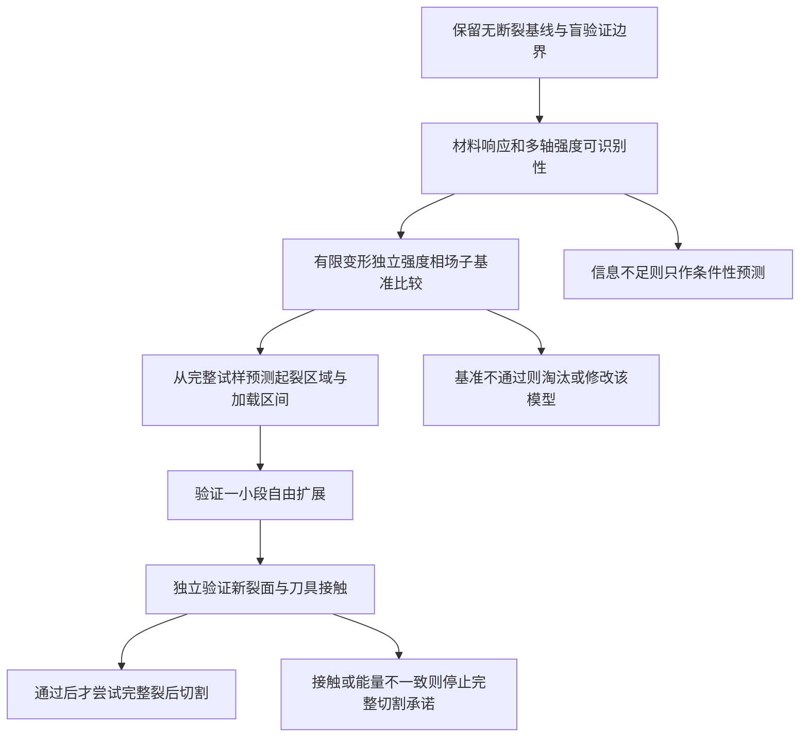

# 橡胶斜切：起裂、扩展与裂后接触的文献可行性评估

检索截止：2026-09-13。本文是针对当前任务的批判性范围检索，不是穷尽检索或 PRISMA 系统综述。结论区分论文已经展示的能力、本项目推演及尚未验证的假设。保留原始实验目标、材料参数和已存档代码；本轮不修改求解器、不启动算例。

## 1. 判断与任务边界

**可以有条件地推进起裂区域和初始裂纹预测；目前没有依据承诺完整的裂后斜切。当前总能量 AT1＋固定外表面 IPC 不具备完成三项任务的物理闭合条件，继续提高迭代上限不能补齐这些条件。**

| 目标 | 文献支持与本项目可行性判断 | 相对难度 | 当前决策 |
|---|---|---|---|
| 从完整试样预测首次起裂位置及加载深度 | 已有独立强度控制的有限变形方法；可以先预测候选区域和条件性起裂区间。现有参数不足以支持准确的材料盲预测 | 场搜索中等；可信的多轴萌生预测高 | 继续，但先过材料、强度与无缺口子基准 |
| 不预设路径，预测初始方向、扩展及分支 | 有限变形相场已有依据；刀具邻域的混合拉剪、压缩和接触使迁移困难 | 高 | 第一目标限于萌生与一小段稳定扩展，逐项验收 |
| 断裂后刀具进入裂缝，材料分离、闭合、滑移及继续切割 | 文献分别解决了部分问题；本次未核实到可直接覆盖本实验全部条件的完整实现 | 很高，可能需要新的数值方法 | 暂不承诺完成；先独立验证新裂面接触，失败则收缩范围或换表示方法 |

难度不能简单按时间顺序排序：**若给定真实初始裂纹，算短程扩展可能比从完整橡胶准确预测首次起裂更容易。**第一项的困难很大部分来自物理信息不足，第三项则同时缺物理闭合与数值实现。均匀连续体也不能保证逐点复现由未知缺陷决定的真实裂纹细节。

目标仍是 [模型规范](current_model_spec.md) 中的有限应变、近不可压缩、二维平面应变斜切，采用用户指定 0.02 mm 刀尖。用户提供的约 1–2 mm 开裂观察只能作后续对照，不能变成触发深度、长度尺度拟合目标或预埋裂纹位置。3 mm 保留为未起裂时的加载上限；不再为了完成无断裂后段而优先修复该后段。

## 2. 检索方法和证据等级

共整理 **37 篇不同研究**，覆盖 2018–2026 年，重点追踪 2023–2026 年进展和相关作者代码。32 篇有期刊/会议 DOI 的条目核对了 DOI 解析与 Crossref 书目；另外 5 项通过 arXiv 和作者来源核对，其中 CRESSim-MPM 有作者托管 IROS 2025 版本，其余四项按预印本处理。DOI 核对只证明文献身份，不证明结论正确或本地实现有效。

实际使用 Crossref、OpenAlex、arXiv，以及出版商与作者机构网站的定向检索和引文追踪。未访问订阅版 Scopus/WoS。数据库广检索三组字符串为 `finite strain phase field fracture rubber contact`、`soft material cutting crack nucleation friction`、`phase field cohesive fracture hyperelastic strength`：OpenAlex 各返回 10 条；Crossref 前两组各返回 10 条，第三组 HTTP 429。另有题名检索，其中 CRESSim-MPM 的 Crossref 查询也限流。50 条广检索记录并非 50 篇入选论文，37 篇清单还包含引文追踪与定向查询结果，不虚构去重流程或筛选人数。

补充检索主题包括独立强度面、有限变形 cohesive phase field、近不可压缩混合单元、裂面闭合/摩擦、第三介质接触、自由裂纹与 MPM、切割端部效应。优先纳入原始研究、作者全文及公开实现；动画切割、岩石摩擦等作为适用边界对照，不能直接充当橡胶验证。日期与查询记录见 [检索日志](literature_search_log.md)。本地机器可读检索/DOI 审计保存在 `outputs/literature_feasibility_20260913/`，不发布原始元数据和全文。

下表阅读等级：**T**＝本轮核对正文中直接影响判断的章节，非逐页通读；**A**＝核对作者/出版摘要、亮点或明确标注的正文检索摘录，尚不足以照公式实施；**L**＝仓库已有全文核查/复现记录，本轮未重读全篇。预印本身份另行标明。A 类方法进入编码前必须取得并复核推导、离散和算例设置。本文没有宣称 37 篇均已全文精读。

## 3. 证据清单

### 3.1 起裂、强度与 cohesive 相场

| 编号、来源 | 核查 | 可参考内容 | 不能据此声称 |
|---|---|---|---|
| F01 Kamarei 等，2025，*Nucleation and propagation of fracture in viscoelastic elastomers: A complete phase-field theory*，[CMAME](https://doi.org/10.1016/j.cma.2025.118337)，[作者全文](https://arxiv.org/html/2506.16479v1) | T，§3.4–3.5、§4 | 有限变形橡胶的独立强度驱动力、断裂能和黏弹性；最贴近材料类别的候选 | 单轴目录强度不足以填满其多轴强度参数；未解决本实验新裂面刀具接触 |
| F02 Lopez-Pamies 等，2025，*Classical variational phase-field models cannot predict fracture nucleation*，[CMAME](https://doi.org/10.1016/j.cma.2024.117520) | L | 对经典 Griffith 正则化缺少独立材料强度的批评，直接警示当前 AT1 | 标题不能外推成“全部相场或全部变分方法都不能起裂” |
| F03 Zolesi、Maurini，2024，*Stability and crack nucleation in variational phase-field models of fracture: Effects of length-scales and stress multi-axiality*，[JMPS](https://doi.org/10.1016/j.jmps.2024.105802) | A，作者摘要/会议说明 | 长度、多轴应力及稳定性对萌生的影响 | 一阶残差收敛即代表正确稳定分支；未完成本地稳定性复现 |
| F04 Lopez-Pamies 等，2026，*Nucleation and propagation of brittle fracture as a constrained energy minimization problem*，[预印本](https://arxiv.org/html/2608.28326v1) | T，§4.2、§5.4、结论 | 将强度约束纳入能量框架，可启发无缺口萌生判据 | 理论主要为时间离散问题，严格结果限于二维线弹性；压入示例使用参数化试探裂纹族，非现成全域自由切割算法 |
| F05 Lammen、Conti、Mosler，2023，*A finite deformation phase field model suitable for cohesive fracture*，[JMPS](https://doi.org/10.1016/j.jmps.2023.105349) | A | 有限变形、可区分强度与断裂能的 cohesive 相场；含闭合/重开讨论 | 未核对全文推导前不能声称已具备摩擦刀具适配；单轴 cohesive 强度不自动等于正确多轴强度面 |
| F06 Lammen、Conti、Mosler，2025，*Approximating arbitrary traction–separation-laws by means of phase-field theory — Mathematical foundation and numerical implementation*，[JMPS](https://doi.org/10.1016/j.jmps.2025.106038) | A | 从牵引—分离关系构造相场，补足裂后牵引衰减描述 | 牵引曲线仍需材料信息；不能凭任意选曲线得到真实橡胶预测 |
| F07 Mandal 等，2020，*A length scale insensitive phase field model for brittle fracture of hyperelastic solids*，[EFM](https://doi.org/10.1016/j.engfracmech.2020.107196) | A | 超弹性下使用 cohesive 型退化，展示模式 I/混合模式；有限变形候选对照 | 文中长度不敏感结果不代表任意网格、摩擦和多轴状态均独立 |
| F08 Dammaß 等，2023，*Phase-field modelling and analysis of rate-dependent fracture phenomena at finite deformation*，[Computational Mechanics](https://doi.org/10.1007/s00466-023-02310-1) | L，仓库独立复现 | 有限变形黏弹性、相场双向耦合与速率效应 | 预缺口 EPDM、平面应力复现不等于无缺口 CB245NE 平面应变斜切 |
| F09 Tanné 等，2018，*Crack nucleation in variational phase-field models of brittle fracture*，[JMPS](https://doi.org/10.1016/j.jmps.2017.09.006)，[作者说明](https://www.lmm.jussieu.fr/~corrado/2017/10/30/crack-nucleation-paper/) | A | 通过赋予内部长度材料意义，在所研究问题中描述强度/尺寸效应；应与 F02 同时阅读 | 不能据其特定成功否认多轴强度限制，也不能据 F02 抹去这些成功 |
| F10 Kamarei 等，2026，*Nine circles of elastic brittle fracture: A series of challenge problems to assess fracture models*，[CMAME](https://doi.org/10.1016/j.cma.2025.118449)，[作者版本](https://arxiv.org/html/2507.00266v1) | A | 用多种萌生/扩展载荷检验模型，适合作为独立验收来源 | 通过一个切割曲线就足以验证强度模型；2025 预印本与 2026 正式文章不是两篇 |
| F11 Kumar 等，2022，*The revisited phase-field approach to brittle fracture: application to indentation and notch problems*，[IJF](https://doi.org/10.1007/s10704-022-00653-z)，[作者摘要](https://arxiv.org/abs/2201.03271) | A | 接触压入诱发萌生与缺口问题的直接先例 | 固体压入先例不自动涵盖橡胶有限应变和切入后的摩擦 |

### 3.2 近不可压缩、网格及材料点离散

| 编号、来源 | 核查 | 可参考内容 | 适用边界 |
|---|---|---|---|
| F12 Tian 等，2022，*Mixed displacement–pressure-phase field framework for finite strain fracture of nearly incompressible hyperelastic materials*，[CMAME](https://doi.org/10.1016/j.cma.2022.114933)，[作者摘要](https://arxiv.org/abs/2112.00294) | A | 混合位移—压力—相场，区分完整材料体积约束和损伤区开裂 | 不是给现有位移单元加一个压力变量便自动解决锁死或接触 |
| F13 Ang 等，2022，*Stabilized formulation for phase-field fracture in nearly incompressible hyperelasticity*，[IJNME](https://doi.org/10.1002/nme.7050) | A | 稳定化混合离散的替代设计 | 需核对稳定化一致性和本地单元；没有刀具耦合验证 |
| F14 George 等，2025，*A phase field formulation for modelling fracture of nearly incompressible hyperelastic materials*，[CMAME](https://doi.org/10.1016/j.cma.2024.117696)，[作者机构](https://cronfa.swan.ac.uk/Record/cronfa68653) | A | 近不可压缩超弹性断裂的近期方案，可比较损伤区体积处理 | 未完成公式/代码复现，不列为已经可用宿主 |
| F15 Chen 等，2026，*A Pressure-Projection Stabilized Hybrid ES-FEM/FEM Formulation for Phase-Field Fracture of Nearly Incompressible Elastomers*，[IJNME](https://doi.org/10.1002/nme.70418) | A | 压力投影稳定化、平滑有限元与相场；近期体积锁死处理 | 新离散需要独立验证，不能继承其算例结果为 IPC 主线保证 |
| F16 Xing 等，2023，*An adaptive phase-field model with variable-node elements for fracture of hyperelastic materials at large deformations*，[EFM](https://doi.org/10.1016/j.engfracmech.2023.109115) | A | 裂纹附近自适应细化与过渡单元，减少全域细化成本 | 细化改变不了缺失的强度面、裂后接触或材料曲线 |
| F17 Zhang 等，2025，*Adaptive phase-field smoothed total Lagrangian material point method for fracture analysis of soft materials involving large deformation*，[CMAME](https://doi.org/10.1016/j.cma.2025.118250) | A | 自适应相场 TLMPM、F-bar 等体积处理，值得列为 FEM 严重畸变后的备选 | 不是低成本替换线性求解器；0.02 mm 刀尖、摩擦及自由裂面仍需验证 |

### 3.3 裂面闭合、摩擦和表示转换

| 编号、来源 | 核查 | 可参考内容 | 适用边界 |
|---|---|---|---|
| F18 Hakimzadeh 等，2022，*Phase-field finite deformation fracture with an effective energy for regularized crack face contact*，[JMPS](https://doi.org/10.1016/j.jmps.2022.104994)，[作者全文](https://arxiv.org/html/2206.15386v1) | T，能量构造、§9、结论 | 裂纹方向相关的有限变形有效能量，区分裂面张开和闭合 | 无摩擦；循环剪切示例为隔离响应而限制分支方向，其他例含初裂纹；不能用这些例证明完全自由路径 |
| F19 Fei、Choo，2020，*A phase-field method for modeling cracks with frictional contact*，[IJNME](https://doi.org/10.1002/nme.6242)，[作者摘要](https://arxiv.org/abs/1905.10547) | A | 无需显式裂面约束的摩擦裂纹应力处理 | 未验证有限应变橡胶与外部刀具进入新裂缝；不直接照搬小应变应力更新 |
| F20 Liu、Wang，2025，*A thermodynamically consistent phase-field model for frictional fracture in rocks*，[IJPlasticity](https://doi.org/10.1016/j.ijplas.2024.104220) | A | 裂面摩擦耗散、方向/接触状态与热力学一致性 | 岩石受压破坏及摩擦参数不移植给橡胶 |
| F21 Li 等，2026，*Bridging crack nucleation and contact in variational phase-field models*，[CMAME](https://doi.org/10.1016/j.cma.2025.118696)，[机构书目](https://cris.technion.ac.il/en/publications/bridging-crack-nucleation-and-contact-in-variational-phase-field-/) | A，出版摘要及作者上传正文检索摘录 | 联合强度、方向、接触的近期构造 | 已见小量展开假设；作者提及萌生压力突降时摩擦耗散处理限制。未完成正式全文审计，不能宣称有限应变刀切已经解决 |
| F22 Kim 等，2026，*A unified variational framework for phase-field fracture and third-medium contact in finite deformation hyperelasticity*，[预印本全文](https://arxiv.org/html/2603.15635v1) | T，§3.4 Remark 2、算例、结论 | 以第三介质传递压缩接触的概念，省去部分显式接触搜索 | **断裂基体采用小应变，第三介质才保留大变形；无摩擦/黏附。**不能依据标题选择其作为本实验直接主线；也未证明刀具进入自由生成的新裂缝 |
| F23 Hussein 等，2020，*A combined adaptive phase field and discrete cutting method for the prediction of crack paths*，[CMAME](https://doi.org/10.1016/j.cma.2020.113329)，[作者机构](https://research.uni-hannover.de/en/publications/a-combined-adaptive-phase-field-and-discrete-cutting-method-for-t/) | A | 相场指引路径后进行离散裂纹表示，启发显式尾迹方案 | 标题的 cutting 指网格切分，**不是物理刀具切割验证**；转换能量/摩擦历史仍需设计 |
| F24 Li 等，2020，*Incremental Potential Contact: Intersection- and Inversion-free, Large-Deformation Dynamics*，[ACM TOG](https://doi.org/10.1145/3386569.3392425)，[作者全文](https://cims.nyu.edu/gcl/papers/2020-IPC.pdf) | L | 有限变形表面接触、碰撞与防穿透；保留现有基线的依据 | 接触库不生成断裂本构和新边界；不能直接对零间隙新生重合裂面继承全部保证 |

### 3.4 直接切割证据和跨方法对照

| 编号、来源 | 核查 | 可参考内容 | 适用边界 |
|---|---|---|---|
| F25 Moreno-Mateos、Steinmann，2026，*Cutting soft materials: how material differences shape the response*，[npj Computational Materials](https://doi.org/10.1038/s41524-025-01869-y)，[2025 作者版本](https://arxiv.org/html/2507.13565v1) | T，§5 体/界面定义及实验段 | 有限变形软材料切割，区分体变形、cohesive、刀面相互作用；很好的切割构件参考 | 数值模型先指定分离面 S0；并非全域任意起裂路径。其沿刀宽的中央起裂不能直接解释为本二维截面刀尖正下方 |
| F26 Zhao 等，2025，*Why cutting is easier than tearing elastomers*，[Nature Communications](https://doi.org/10.1038/s41467-025-58483-1) | T，实验机制与结果 | PDMS 的链断裂证据提示刀具改变过程区，切割和撕裂的表观能量可能不同 | 不能将 PDMS 数据代入 CB245NE，也不能单凭本文证明当前 Gc 数值错误 |
| F27 Goda 等，2024，*Cutting soft matter: scaling relations controlled by toughness, friction, and wear*，[Soft Matter](https://doi.org/10.1039/D4SM00279B) | A | 刀/线半径、断裂耗能与摩擦磨损的力学竞争 | 稳态力标度不提供任意起裂位置与路径预测 |
| F28 Goda、Labonte、Bacca，2024，*Making the Cut: End Effects and the Benefits of Slicing*，[EML](https://doi.org/10.1016/j.eml.2024.102221)，[作者摘要](https://arxiv.org/abs/2310.18595) | A | 所研究切割中最大拉应力出现在前方自由表面，提醒端部效应和平面假设 | 不能反推所有试样一定表面先裂；必须核对本实验宽度、边界和观测面 |
| F29 Goda、Bacca，2025，*Cutting mechanics of soft compressible solids – Force-radius scaling versus bulk modulus*，[Mechanics of Materials](https://doi.org/10.1016/j.mechmat.2025.105271) | A | 体积响应会影响刀半径—力关系，不能只关注剪切模量 | 不提供本实验材料可压缩性的独立标定 |
| F30 Spagnoli 等，2019，*Cutting resistance of soft materials: Effects of blade inclination and friction*，[TAFM](https://doi.org/10.1016/j.tafmec.2019.02.017) | L，本地论文与方法笔记 | 倾角、滑切和摩擦对力的贡献 | 角度定义、稳态假设和摩擦形式需对齐；不证明简单库仑或黏性摩擦普遍正确 |
| F31 Jamdagni、Jia，2024，*Robotic Cutting of Fruits and Vegetables: Modeling the Effects of Deformation, Fracture Toughness, Knife Edge Geometry, and Motion*，[IEEE T-RO](https://doi.org/10.1109/TRO.2024.3462943)，[作者全文](https://faculty.sites.iastate.edu/jia/files/inline-files/TRO24.pdf) | A，作者正文检索摘录 | FEM、刀尖几何、局部重网格、刀具与裂纹推进关系 | 假设 A4 限制断裂在切割平面内，采用 LEFM；不是自由路径超弹性橡胶解法 |
| F32 Ou、Tavakoli，2025，*CRESSim-MPM: A Material Point Method Library for Surgical Soft Body Simulation with Cutting and Suturing*，[作者全文](https://arxiv.org/html/2502.18437v1)，[IROS 版本](https://www.ece.ualberta.ca/~tbs/pmwiki/pdf/Ou-IROS-2025a.pdf) | T，§III-C、§IV-B | 通过场标签阻断跨切面传递，展示复杂软体分离和接触 | 切面来自几何切割规则，不是独立强度/Gc 控制的自由萌生；作者指出 PBMPM 刚度随迭代设置改变，不能直接迁移其实时性能 |
| F33 Wolper 等，2020，*AnisoMPM: Animating Anisotropic Damage Mechanics*，[ACM TOG](https://doi.org/10.1145/3386569.3392428)，[作者全文](https://www.math.ucla.edu/~cffjiang/research/wolper2020aniso/Wolper2020_AnisoMPM.pdf) | A，作者正文检索摘录 | 各向异性损伤、撕裂/穿刺及开源 MPM，说明拓扑处理有替代方向 | 物理动画中的定性表现与艺术控制不等于本材料起裂深度、力和裂纹路径验证 |

### 3.5 2025–2026 年新增的强度面替代路线

| 编号、来源 | 核查 | 可参考内容 | 适用边界 |
|---|---|---|---|
| F34 Bourdin、Marigo、Maurini、Zolesi，2025，*A variational approach to fracture incorporating any convex strength criterion*，[预印本全文](https://arxiv.org/html/2506.22558v1) | T，框架与本构段 | 通过强度退化而非仅刚度退化纳入凸强度域，给出 cohesive 极限的构造思路 | 当前线性应变框架与理论结果不能直接移植到有限应变刀切；仍需真实强度域 |
| F35 Bourdin、Maurini，2026，*Strength-degradation phase-field regularization of cohesive fracture: the antiplane case*，[预印本全文](https://arxiv.org/html/2607.29157v1) | T，摘要、问题设置与求解结构 | 刚度、强度、韧性可独立指定；反平面问题采用凸优化子问题 | 反平面剪切不是二维平面应变，子问题凸性不保证橡胶接触整体凸或稳定 |
| F36 Hageman，2026，*Cohesive phase-field fracture with an explicit strength surface: An eigenstrain-based return-mapping formulation*，[EFM](https://doi.org/10.1016/j.engfracmech.2026.112292)，[作者全文](https://arxiv.org/html/2603.21811v1) | T，§2 及算法说明 | 特征应变局部返回映射和一致切线；无需添加相对于常规相场的额外全局自由度，有公开代码 | 正文实际采用小应变线弹性。作者说可扩展不等于已完成有限应变橡胶、客观强度更新和摩擦切割验证 |
| F37 Vicentini 等，2026，*Variational phase-field modeling of cohesive fracture with flexibly tunable strength surface*，[JMPS](https://doi.org/10.1016/j.jmps.2025.106424)，[作者全文入口](https://www.research-collection.ethz.ch/server/api/core/bitstreams/68140ea1-28a4-4cb2-8e94-432bf4a92b97/content) | A | 可调强度面、特征应变与 cohesive 相场，另有公开有限元实现 | 先作为独立强度方案的交叉校验；本轮未核对其全部有限运动学适用条件，不列为可直接接入的橡胶切割宿主 |

## 4. 三个问题为什么不能直接串成“加相场即可切开”

### 4.1 找到大应力区域，与预测首次起裂不同

最大应力位置会受网格、刀尖分辨率、接触压力和边界尖点影响；具有最大单点值的区域不一定能支付有限裂纹的形成代价。全域筛查应保留材料坐标/当前坐标、拉剪与压力状态、候选区域宽度及随载荷的持续性，避免仅返回一个单元编号。普通 AT1 的长度控制有效强度，不能通过调 ell 让裂纹恰好在观察深度出现。F02/F03/F09 与 F34–F37 的不同观点说明，应比较具体模型及标定前提，不能按“变分/非变分”标签直接淘汰整类方法。

F01 和 F05/F07 支持继续研究有限变形、强度与断裂能分开的模型。现阶段优先比较 **F01 完整相场** 与 **F05/F07 有限变形 cohesive 相场**：前者更贴近橡胶多轴萌生，后者有不同的牵引退化与强度描述。F36 的局部返回映射可作为实现设计参考，但其小应变代码不作为有限变形主线的直接替代。

当前 G、ν 及目录拉断指标并不唯一决定大应变超弹性曲线、多轴强度面、Gc 或界面摩擦。名义应力、Cauchy 应力和第二 Piola 应力不能直接共用一个数值阈值。缺少独立参数时，只能给出明确假设下的预测及敏感性范围；不同合理假设若改变左右侧判断，就必须报告位置未识别。用户保留的力/DIC 是盲验证数据，不要求提前提供，也不反向用于补齐这些参数后仍称盲预测。

“时刻”也要定义：准静态求解首先预测加载深度/位移区间；只有加载速度和时间零点明确，且速率效应已处理或有依据忽略时，才能换成实验时间。首次非零 d、稳定局部损伤、出现连续裂面以及视频首次可见裂痕是不同事件，不能混用。

### 4.2 路径可以自由产生，但真实增长要求额外物理

相场使初始 d=0 的完整域具备无需预设一条裂纹线的表示能力；这只是必要条件。还需材料在拉伸、剪切、压缩/约束拉伸中的正确驱动力，近不可压缩离散，以及裂面张开时释放牵引、闭合时恢复压缩传力。F12–F15 支持审查位移—压力—损伤耦合；F18 说明仅作常规正负能量分解未必正确描述有限变形裂面状态。

优先选择混合位移—压力—损伤方案做基准比较，但不先宣布当前停点全由体积锁死导致。压力处理改变了离散和损伤区体积约束，必须验证一致性。完整橡胶近不可压缩不等于张开的裂缝也被强迫保持体积；相反，统一退化全部压缩承载又可能造成不合理塌陷。

初裂后若出现跳跃，位移控制和交替最小化也不保证追踪到物理分支。须检查稳定性、增量能量及历史；若真实快速断裂需要惯性，应采用有依据的动力学，而非把求解器伪时间当实验时间。网格细化、步长细化和 ell 扫描应分别进行：若 ell 是材料尺度，改变它就是改变模型；若声称纯数值正则化，则须在固定强度/Gc 下展示相应极限趋势。

### 4.3 裂后关系至少包含三种承载状态

| 状态/界面 | 应有描述 | 当前实现缺口 |
|---|---|---|
| 完整橡胶与断裂过程区 | 完整区保留有限应变体响应；过程区按已定义断裂律逐渐减小可传递牵引并耗散 | 总能量 AT1 尚未建立经过验证的强度和模式响应 |
| 已分离裂面 | 张开时不传递非物理拉力；闭合可传压，必要时有裂面摩擦 | 标量损伤不会自动给 IPC 产生可碰撞的新面 |
| 刀具与原外表面/新裂面 | 刀具不能穿过任一真实材料面；接触压力、滑移和界面耗散随几何更新 | 当前 IPC 接触边界固定，缺新裂面几何、接触历史与一致初始化 |

残余刚度是数值正则化，不能作为“断裂后橡胶仍有微弱拉力”的材料解释。损伤完全发展后还保留一条可任意拉伸的连续软带，也不等于两块材料真正分离。若采用相场到离散裂面的转换，要保证几何、能量与历史一致，避免同时支付 cohesive 能和重复的相场断裂能；新生重合面也不能直接送进需要可行初态的屏障。

F23 支持研究混合表示，F24 支持后续接触，但“相场尾迹显式化＋IPC”仍是本项目待验证的工程组合。F22 第三介质目前不适合直接替换。F25 是值得借鉴的刀具/界面结构，却通过预设切面降低了自由路径难度。MPM（F17/F32/F33）可改变几何和拓扑处理成本，不能消除强度、耗散、裂面摩擦与刀尖分辨率问题。

### 4.4 二维结果与侧面视频必须分别定义

F28 提示切割端部自由表面和内部截面的应力峰值可能不同；F25 的中央区又可接近平面应变。这不是文献矛盾，而是不同几何/约束及观测位置不能直接互换。本实验继续使用有出平面宽度的二维平面应变作为近似，但乘上 20 mm 宽度只完成力/能量尺度换算，不能验证首次裂纹沿宽度均匀出现。

在将二维起裂点与侧面视频比较之前，应明确视频侧面是否是平面应变代表面。必要时做局部或较粗的三维无损伤对照，比较自由表面与内部候选区域；这属于后续验证方案，本轮未计算。若两者不一致，必须限制二维结论，不能靠移动预设弱区把预测拉到视频位置。

## 5. 推荐路线、验收与停止条件

以下是本项目提出的验收设计，不是所引论文已替我们完成的验证，也不是成功率/工期承诺。

1. **先核对材料与强度。**用相同应力度量检查单轴、剪切、双轴/静水等均匀状态；无缺口起裂及受压开闭基准用于淘汰错误驱动力。强度面未识别就显式保留未知参数，不能任意选静水强度再宣称材料预测。F10 的挑战问题可选取相关子集。
2. **比较有限变形候选，暂不写全套裂后算法。**优先深入 F01 与 F05/F07；以同一材料假设、强度与 Gc 比较，避免每个方法各调一套参数。F34–F37 作独立强度面与求解结构对照。预缺口基准允许给定裂纹，因为是在验证传播构件；生产起裂算例仍必须完整、无预设路径。
3. **从零加载预测起裂并给出区间。**保留统一不可逆历史和接触历史。诊断单点峰值是否随网格迁移；至少在子基准上比较三档网格、两档加载步，以及与所选相场解释一致的长度尺度对照。事先规定位置/深度/能量的数值误差容限，并据结果估计误差，不能看完实验再定标准。
4. **只推进起裂附近的短段。**同时比较方向、裂面开度、反力和耗能；查网格方向偏置、压缩开裂与闭合传力。存在相近的竞争分支时给出候选集合和扰动敏感性，不把一次迭代选中的路径解释为唯一真实答案。
5. **新裂面接触单独设关口。**先在独立构件中检验一个已知裂缝的张开—闭合、滑移，再检验刀具进入由算法生成的裂缝。分别检查正 J、防穿透、开口面牵引、压缩承载、摩擦耗散及断裂能是否重复计算。仅旧外表面接触通过，不允许启动“完整切割验收”。

**明确停止条件：**合理参数范围内左右候选不稳定且无法缩小不确定性，则当前数据不能支持唯一位置；固定物理参数后起裂/方向持续随网格或正则化改变，则该离散/模型未通过；新裂面需要放松防穿透、虚增残余承载、跳过能量或指定刀下裂纹才可运行，则该完整切割方案淘汰。参数缺失、模型不适用和代码错误应分别报告，不能统称“再细化就行”。

后备方向按已识别瓶颈选择：FEM 几何畸变主导才优先评估 F17；裂面表示主导才优先评估 F23 的混合表示；强度不可识别则换任何求解器都不能解决盲预测信息不足。没有必要为了“算法创新”同时重写这些层次。

## 6. 与仓库的关系及可用代码线索

目前 `prototype.ipc_initiation` 是全域候选筛查；`prototype.phase_field` 与 `prototype.ipc_fracture` 是经典总能量 AT1 对照及其力学反馈。已有固定深度检查不能拼成从零演化，也没有证明形成真实裂纹。数值状态只在 [solver_status.md](solver_status.md) 维护，避免在研究文档中重复运行结果。

本评估将此前“相场尾迹显式化并接 IPC”的确定安排调整为**待关口验证的候选**。本轮保留代码，未修改材料/摩擦、未重跑或推送 Git。论文、视频、实验和数值数据继续留本地；本文只含自主方法摘要与来源。

已核对公开入口但**未安装、未运行、未审计全部源码**的实现包括 [Kamarei/Lopez-Pamies FEniCSx](https://github.com/farhadkama/FEniCSx_Kamarei_Lopez-Pamies)、[Hageman cohesive FEniCSx](https://github.com/T-Hageman/Cohesive-PhaseField-FenicsX)、[Vicentini 等 cohesive 相场](https://github.com/jonas-heinzmann/phase_field_cohesive_fracture) 和 [CRESSim-MPM](https://github.com/yafei-ou/CRESSim-MPM)。优先复现与目标有关的原作者子基准，再评估接口迁移；开源可访问不等于本地可用或实验适用。
