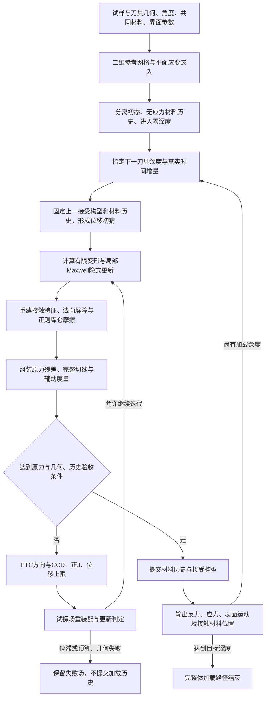

# 橡胶斜向压入仿真：理论模型流程、当前问题与可能影响因素

## 1. 当前仿真理论模型及流程

### 1.1 模型对象与物理范围

模型描述刚性刀具沿实验室竖直方向压入橡胶的准静态过程，输出刀具反力、橡胶变形、应力及刀尖邻近材料的参考位置。不同入侵角度采用同一材料模型和同一组材料参数。

当前实际工况模型由以下部分组成：

| 层次 | 当前采用的描述 |
|---|---|
| 几何与运动学 | 二维平面应变，有限变形、有限转动；刚性刀具竖直平移 |
| 橡胶平衡响应 | 等容 neo-Hookean 超弹性与二次体积能 |
| 橡胶时间响应 | 与平衡支路并联的单个有限应变、等容 Maxwell 支路 |
| 法向接触 | IPC 有限间隙屏障势，improved-max 离散组合 |
| 切向接触 | 正则化库仑摩擦，统一摩擦系数 μ=0.35 |
| 自接触 | 橡胶边界自接触与刀具接触均参与碰撞检测和接触装配 |
| 空间离散 | 纯位移 P1 线性三角形，单元内常变形梯度 |
| 全局求解 | 刷新接触的非对称力平衡迭代，伪瞬态延续稳定化 |
| 历史变量 | 材料逆黏性度量、上一接受构型及摩擦增量参考 |
| 当前未包含的物理过程 | 起裂、损伤、裂纹扩展、材料分离、塑性永久变形、热传导、流体润滑和刀具弹性 |

“Maxwell”指橡胶内部的黏弹支路，不是界面摩擦定律；界面采用库仑摩擦近似，不是独立标定的黏性剪切定律。整体材料包含非零长期剪切刚度，因此也不同于长期剪切刚度为零的单独 Maxwell 元件。

以下规格及结果对应截至2026-10-21的实际工况模型。独立局部接触核、混合元及高阶单元诊断不属于该模型的正式加载结果。

### 1.2 几何、坐标、加载与边界

| 项目 | 数值或定义 |
|---|---|
| 橡胶参考截面 | 长30 mm，高5 mm |
| 面外宽度 | 20 mm；以积分权重计入总力，不建立面外网格 |
| 初始落刀材料位置 | 沿参考上表面距局部坐标原点7 mm |
| 计算角度 | 0°、33°、57° |
| 刀具型号与截面 | 99755，厚0.245 mm，对称双刃，总楔角23° |
| 刀尖圆鼻半径 | 0.02 mm，模型指定值；现有规格截图未提供该微观半径的实测值 |
| 圆鼻离散 | 64条直线面片近似圆弧 |
| 运动 | 刀具不转动，沿实验室竖直方向下行 |
| 下行速度 | v=0.2 mm/s |
| 支承 | 橡胶底面两个平移方向均固定 |
| 其余橡胶边界 | 未接触区域无外加表面牵引；满足接触条件的区域承受接触作用 |
| 力、长度、时间单位 | N、mm、s；应力及模量单位MPa=N/mm² |

取实验室水平轴为 x，竖直向上轴为 y。初始材料表面切向和外法向为

\[
\mathbf e_s=(\cos\theta,-\sin\theta),\qquad
\mathbf e_n=(\sin\theta,\cos\theta).
\]

角度 θ 为初始材料表面相对实验室水平面的倾角，也等于竖直压入方向与初始材料内法向之间的夹角。模型通过旋转试样及其固定底面改变 θ，刀具方向保持不变。

刀具下行深度 d 为正，刀具位移为 \((0,-d)\)。相对于初始材料表面的名义压入与切向运动分量为

\[
d_n=d\cos\theta,\quad d_s=d\sin\theta,\qquad
v_n=v\cos\theta,\quad v_s=v\sin\theta.
\]

| θ | d=0.5 mm时的名义法向压入 dₙ / mm | 名义切向运动 dₛ / mm | vₙ / (mm/s) |
|---|---:|---:|---:|
| 0° | 0.500000 | 0 | 0.200000 |
| 33° | 0.419335 | 0.272320 | 0.167734 |
| 57° | 0.272320 | 0.419335 | 0.108928 |

这些量是刀具刚体运动相对于初始材料坐标的投影，不等于变形后的局部接触压入量、材料点滑程或刀尖接触点迁移。同样 d、同样 v 对应从深度零点起相同的加载时间 t=d/v；0.5 mm对应2.5 s。法向速度较小不等于同一刀具行程经历更长的加载时间。

仿真深度零点定义为理想圆鼻与初始未变形平面的名义几何首触。计算从分离状态进入零深度；有限距离屏障可在名义首触前产生作用，故零深度接受态不必为无载态。分离到零深度的材料和摩擦历史也属于计算历史。

### 1.3 有限变形与材料状态

参考材料点 \(\mathbf X\) 的当前位置为 \(\mathbf x=\mathbf X+\mathbf u\)。二维变形梯度嵌入三维：

\[
\mathbf F=
\begin{bmatrix}
F_{11}&F_{12}&0\\
F_{21}&F_{22}&0\\
0&0&1
\end{bmatrix},\qquad
J=\det\mathbf F>0.
\]

平面应变约束为面外伸长固定为1，面外正应力一般不为零。三维等容分解仍使用 \(J^{-2/3}\)，并保留面外分量对不变量及应力的贡献。

平衡支路应变能密度为

\[
W_\infty(\mathbf F)
=\frac{G_\infty}{2}(\bar I_1-3)
+\frac K2(J-1)^2,
\qquad
\bar I_1=J^{-2/3}\operatorname{tr}(\mathbf F^T\mathbf F).
\]

该支路对应单项 Ogden 指数2的 neo-Hookean 形式。体积项的 Cauchy 应力为 \(K(J-1)\mathbf I\)，没有独立体积松弛支路。二次体积能在 J趋近0时保持有限，正J由几何与接受条件另行约束。

非平衡支路采用乘法分解 \(\mathbf F=\mathbf F_e\mathbf F_v\)，保存

\[
\mathbf A_v=\mathbf C_v^{-1},\qquad
\mathbf b_e=\mathbf F\mathbf A_v\mathbf F^T,
\qquad \det\mathbf A_v=1.
\]

\(\mathbf A_v\) 为对称正定张量。支路弹性能为

\[
W_v=\frac{G_v}{2}\left(J^{-2/3}\operatorname{tr}\mathbf b_e-3\right).
\]

在主对数弹性伸长空间，当前实现以局部后向Euler方程更新：

\[
\mathbf e_e-\mathbf e_{\mathrm{trial}}
+\frac{\Delta t}{2G_v\tau}
\operatorname{dev}\boldsymbol\tau_v(\mathbf e_e)=\mathbf0.
\]

其中 \(\boldsymbol\tau_v\) 为支路主Kirchhoff应力，trial状态由本增量的总变形和上一接受的逆黏性度量构造。总应力为平衡支路、非平衡支路之和；局部隐式更新的导数进入全局一致切线。

在无穷小剪切应变极限，连续时间松弛模量为

\[
G(t)=G_\infty+G_v e^{-t/\tau},\qquad
G_0=G_\infty+G_v.
\]

τ为小应变剪切松弛时间。有限变形下，支路应力与弹性伸长非线性关联，局部应力衰减不必保持同一个时间常数，也不必为单指数。

| 参数组 | G∞ / MPa | Gᵥ / MPa | G₀ / MPa | τ / s | K / MPa |
|---|---:|---:|---:|---:|---:|
| 共同参考组 | 0.1400 | 1.2400 | 1.3800 | 1.7 | 23.34333333333331 |
| q30独立对照 | 0.2898 | 0.6762 | 0.9660 | 1.7 | 同上 |
| q50独立对照 | 0.4830 | 0.4830 | 0.9660 | 1.7 | 同上 |

q30、q50指长期剪切刚度占瞬时剪切刚度的比例，不是角度。每组内部不同角度使用相同参数。这些参数是仿真假设，尚非独立材料试验确定的整套常数。

K与G分别控制体积和剪切响应。共同参考组的小应变瞬时与长期等效泊松比分别约0.4710和0.4970，由

\[
\nu=\frac{3K-2G}{2(3K+G)}
\]

计算；不能把该材料描述为全程固定ν=0.49。

### 1.4 法向接触与库仑摩擦

连续体无黏附接触的理想约束可表示为间隙非负、压缩接触压力非负及互补条件。当前离散实现以屏障势近似该约束：

\[
g>0,\qquad B(g)=0\ \text{当}\ g\geq\hat d,
\qquad B(g)\rightarrow+\infty\ \text{当}\ g\rightarrow0^+.
\]

实际接触势由IPC距离核、面积权重及improved-max组合构造，包含点—边（EV）和点—点（VV）等离散特征。屏障激活距离 \(\hat d=0.0025\) mm；屏障刚度参数为6.6 MPa，并按面外宽度缩放。该参数是接触离散参数，不是橡胶剪切模量，也不随材料剪切参数自动同步改变。

刀具与橡胶、橡胶与自身的候选接触在当前构型重新建立。非相交由连续碰撞检测（CCD）和接受态检查共同约束。improved-max中的带符号组合项不能逐项解释为独立接触面积或独立正压力。

理想库仑摩擦的局部牵引条件为

\[
\|\mathbf t_t\|\leq\mu p_n,
\qquad
\mathbf t_t=-\mu p_n
\frac{\mathbf v_{\mathrm{rel},t}}{\|\mathbf v_{\mathrm{rel},t}\|}
\quad\text{在滑动时}.
\]

当前使用统一常数 \(\mu=0.35\)，没有独立静、动摩擦系数，没有压力、温度或滑速相关的实测μ函数，也没有流体膜或界面黏附牵引。

数值上，以 \(\Delta\mathbf x=\mathbf x_n-\mathbf x_{n-1}\) 的接触切向投影构造平滑摩擦势。对单个正法向载荷接触项，摩擦大小相对于 \(\mu N\) 的平滑系数为

\[
m(r)=
\begin{cases}
2r-r^2,&0\leq r<1,\\
1,&r\geq1,
\end{cases}
\qquad r=\frac{|\Delta s|}{\epsilon_u},
\qquad \epsilon_u=10^{-5}\ \mathrm{mm}.
\]

平滑区允许有限的正则化滑移，不能等同于理想库仑律的严格零滑移黏着。小增量区的力—滑移关系具有近似线性形式，但其系数由μ、法向承载及数值阈值决定，不是独立物理黏度。

材料真实时间步为 \(\Delta t=\Delta d/v\)。因此，固定εᵤ对应的等效速度阈值为

\[
\epsilon_v=\frac{\epsilon_u}{\Delta t}.
\]

Δd=0.01 mm时，Δt=0.05 s，εᵥ=0.0002 mm/s；Δd=0.005 mm而εᵤ不变时，εᵥ变为0.0004 mm/s。独立固定速度阈值对照使用εᵥ=0.0002 mm/s，并令εᵤ=εᵥΔt。

每次全局试探均刷新接触几何和法向承载，并据此重算摩擦残差；相对于上一接受构型的历史参考不随内部迭代推进。刷新法向力和接触基底的导数使完整力切线一般非对称，不能把它直接等同于冻结接触势的Hessian。[IPC Toolkit接触与摩擦定义](https://ipctk.xyz/tutorials/getting_started.html#friction)给出库函数的基本形式；这里的位移输入及εᵤ取值来自当前程序。

### 1.5 离散平衡与求解

橡胶采用P1三角形，每个单元内的变形梯度和材料历史为常量。体内残差以单元参考面积乘20 mm面外宽度积分；没有独立压力自由度。局部网格间距0.05 mm、上表面间距0.005 mm、细区半宽3 mm，外围为较稀疏网格。

第n个加载增量的自由节点平衡方程为

\[
\mathbf r_f(\mathbf x_n;
\mathbf A_{v,n-1},\mathbf x_{n-1},\Delta t_n)
=\mathbf f_{\mathrm{bulk},f}
+\mathbf f_{\mathrm{normal},f}
+\mathbf f_{\mathrm{friction},f}=\mathbf0.
\]

刀具节点施加指定位置，底面节点固定。主线不包含质量惯性项、重力或动力学阻尼项；材料黏性仍通过真实Δt进入准静态平衡。

非线性方向采用伪瞬态延续（PTC）：

\[
(\mathbf A+\gamma\mathbf M)\Delta\mathbf u=-\mathbf r_f.
\]

\(\mathbf A\) 是刷新接触后的力切线；\(\mathbf M\) 是正半定投影构造的辅助度量，并加 \(10^{-9}\) N/mm对角正则；γ是迭代稳定化参数，不是物理黏度。方向步长受CCD、单元正J路径条件及刀尖尺度位移上限约束。更新允许残差非单调，最终加载接受仍使用未加稳定化的原力残差。

当前有界对照使用每增量最多500次PTC迭代及40次无规定进展的停滞判据。物理接受条件包括自由节点残差二范数不超过 \(10^{-4}\) N、J为正、边界不相交、指定边界满足、逆黏性度量正定且等容、材料与摩擦离散耗散非负。数值容差内的平衡不等于空间收敛或实验有效性。

### 1.6 模型计算流程

每次材料试探从同一个上一接受状态积分，内部非线性迭代不额外累计材料时间或摩擦滑程。失败增量不构成新的加载历史。

### 1.7 反力与接触位置观测

Fz定义为材料作用于刀具的竖直向上反力，压入时通常为正；由刀具节点的全部接触作用求和。它既不是初始材料表面的法向合力，也不是单独的摩擦力。

令总反力 \(\mathbf R=(R_x,F_z)\)，定义 \(N=\mathbf R\cdot\mathbf e_n\)、\(T=-\mathbf R\cdot\mathbf e_s\)，则

\[
F_z=N\cos\theta+T\sin\theta,
\qquad F_zv=Nv_n+Tv_s.
\]

这是坐标和功率分解。T同时包含刀具楔面法向力投影和摩擦投影，T/N不等于界面μ。局部法向接触力的竖直分量也不等于N。刀具水平速度为零时，水平反力不能作为额外竖直功项直接叠加。

刀尖材料位置观测采用当前原始上表面边的最近投影，按边插值系数回溯到参考构型，输出

\[
\Delta s_0=s(\mathbf X_{\mathrm{contact}})-7\ \mathrm{mm}.
\]

仅当最近投影间隙小于屏障激活距离时记录接触候选；无接触或多义时保留相应状态。另记录整个圆鼻及整刃邻近的参考材料区间。\(\Delta s_0\) 表示接触材料身份的迁移，不是界面累计滑程、当前表面弧长、压力中心或严格零间隙接触真值。

## 2. 当前问题及已有证据范围

### 2.1 实验对象与比较定义

当前定量比较采用三个Fz导出文件：0°为1008n0a2，33°为1008n33a1，57°为1014n57a1。力保留导出的N值和零点，只将深度μm转换为mm。0°、33°导出首值为0 N；57°首值为0.51 N，未另行平移。

三条曲线来自不同试次，其中57°与另外两条的日期不同；共同橡胶属性是比较前提，试次差异不表示采用不同材料参数。现有三条曲线在全部浅层深度上并不具有严格的Fz角度单调排序。

实验后段包含断裂。33°约1.2–1.3 mm起裂属于近似估计；0°约1 mm的估计对应1008n0a1，不直接适用于当前1008n0a2；57°起裂深度未确定。以下早期区间属于暂定完整体比较窗口，不代表全部帧已经被独立确认为未起裂。

### 2.2 力值与角度响应偏差

共同参考材料的三条完整体路径均已计算到2 mm。其早期结果为：

| 竖直深度 / mm | 0°实验 / N | 0°仿真 / N | 33°实验 / N | 33°仿真 / N | 57°实验 / N | 57°仿真 / N |
|---|---:|---:|---:|---:|---:|---:|
| 0.4 | 6.290 | 9.495 | 5.820 | 9.642 | 6.850 | 7.146 |
| 0.5 | 8.270 | 11.485 | 7.610 | 11.642 | 8.480 | 9.077 |
| 1.0 | 18.290 | 20.941 | 16.450 | 21.020 | 17.690 | 17.279 |

在0.4–0.5 mm，0°与33°的仿真力均偏高，且33°略高于0°；对应实验33°低于0°。57°在上述点的数值更接近实验，但57°参与过材料参数选择，不构成独立的跨角度验证。

较低瞬时剪切刚度、不同松弛份额对照在0.5 mm的结果为：

| 参数组 | 0° / N | 33° / N | Fz₃₃−Fz₀ / N |
|---|---:|---:|---:|
| 对应实验 | 8.2700 | 7.6100 | −0.6600 |
| q30 | 9.5194 | 9.6153 | +0.0960 |
| q50 | 10.8191 | 10.8812 | +0.0622 |

q30的33°曲线在约0.31–0.32 mm超过0°。这两组对照未同时消除幅值与角度响应偏差。

### 2.3 曲线形状偏差

以各区间内的全部原始样本做带截距线性回归，区间斜率为：

| 角度 | 实验0.10–0.25 mm / (N/mm) | 实验0.25–0.50 mm / (N/mm) | 共同参考仿真0.10–0.25 mm / (N/mm) | 共同参考仿真0.25–0.50 mm / (N/mm) |
|---|---:|---:|---:|---:|
| 0° | 16.61 | 17.81 | 24.21 | 20.20 |
| 33° | 14.88 | 15.84 | 24.89 | 21.36 |
| 57° | 15.09 | 16.07 | 16.29 | 20.57 |

0°和33°实验的后一区间斜率略高，而共同参考仿真斜率下降；57°仿真的斜率增幅又大于对应实验。不同角度的曲线形状偏差不同，单一力幅值比例不能同时描述这些偏差。区间回归斜率不是逐点二阶导数，也不直接判定起裂。

q30的0°在0.4 mm为7.6565 N，实验为6.2900 N；其0.25–0.40 mm割线斜率为18.115 N/mm，接近实验17.600 N/mm，但已积累的力值偏差仍存在。局部斜率接近与整段曲线接近是不同条件。

### 2.4 已识别的接触与计算现象

| 已有现象 | 证据范围 | 尚不能据此确定的内容 |
|---|---|---|
| 有限间隙下共同刚体转动产生非零摩擦功 | 接触夹具和实际承载几何的施加转动检查均出现该作用 | 实际压入Fz中由该作用造成的误差比例 |
| 部分连续相邻边界节点产生屏障排斥及摩擦 | 部分实际接受场、失败场可分离出相邻VV项 | 所有失效或角度反转的共同原因 |
| q30的33°相邻VV项在0.48 mm首次出现 | 角度曲线交叉发生于0.31–0.32 mm | 该项不是这条路径上交叉起始的解释 |
| 摩擦正则随真实步长改变等效速度阈值 | 固定法向力测试及保存场条件测试得到一致结果 | 步长变化造成的全部FE路径误差 |
| 两种半步正则的0°、33°均完成1 mm | 对应终点Fz差小于0.003 N，均保留明显实验偏差 | 该正则差异不能单独解释这些终点的数牛顿偏差 |
| 两种半步57°均接受至0.130 mm，在0.135 mm失败 | 接触切换附近无法满足原力残差验收 | 断裂发生、物理上不存在平衡解或接触力存在有限跳跃 |
| 原失败场包含刀鼻边内投影与顶点切换 | 一侧法向导数不同，扰动减小时力差缩小 | 已定位切线折点，但未证明力本身不连续 |
| PTC方向和实际残差进展不一致 | 部分原失败增量的原方向重放得到预测下降而实际上升，另有预测本身上升的方向 | 不能将此局部证据推广为全部加载偏差的原因 |

对最近三组共同材料57°失败，253个接受的PTC内部更新均记录α=1；这些记录不支持“连续几何截短小步伴随稳定化衰减”作为这三次失败的解释。

单独删除相邻VV项的切换测试出现约5.59 N力跳变，而原组合在同一极小扰动下约为5.65×10⁻⁹ N；删除对照也未通过原失败增量。该结果涉及组合接触核的连续性，不构成当前模型应排除真实自接触的依据。

局部客观接触力核仅覆盖正权重、旧新投影持续处于同一条边内部的接触，未覆盖全部VV、跨边历史和组合项，未进入上述全局加载结果。

### 2.5 材料与体积响应的证据边界

q30的0°、33°共八个实际场、185个材料点通过有限转动、材料切线差分、逆黏性度量及耗散检查。这些检查支持实现与所写材料方程一致，不证明参数或方程已代表真实橡胶。

在q30的0.5 mm状态，0°、33°的最小J分别约0.501、0.457；全体积加权平均J分别约0.99947、0.99944。极端局部压缩与整体近等容同时存在，平均值不能替代刀尖局部状态。33°中J<0.5的区域仅占初始总体积约8.33×10⁻⁸。

共同参考材料0.5 mm实际场的选定承载区域，在固定总变形的0.1 s材料点停留中，Maxwell支路应力积分分别下降约9.6%、11.2%、8.8%；该量不是整块试样自由重平衡后的Fz松弛率。

在固定上一接受材料与摩擦历史的q30状态，以完整切线计算的K局部条件灵敏度表明：0.4 mm处K改变约1%，0°和33°Fz分别变化约0.0052和0.0062 N，角度力差变化约0.001 N。它不等于完整加载路径的参数灵敏度，也不确定更换体积能、二维约束或离散方式的影响。

### 2.6 实验辨识与接触观测的未定部分

单一速度下的Fz曲线同时受材料、接触、几何、支承和时间历史影响。目前尚未从独立材料及界面试验确定整套G∞、Gᵥ、τ、K和μ，也未确定仅凭Fz对这些量的唯一辨识性。

侧视光流观测的是可见表面纹理运动，仿真接触偏移观测的是材料参考坐标；两者的观测定义不同。实验交付的实验室坐标标定、机械首触和力—视频同步未全部确认。轨迹有效性与初始参考段需要分别区分，断点重置后的新参考段不是相对于原始构型的累计位移。

本节数值依据为保存的三角度共同参考路径、q30/q50路径、对应实验CSV以及2026-10-20至21的接触和材料场审查；接受态、条件扰动场和失败场分别陈述，没有将条件代数修改后的力作为新平衡结果。

## 3. 可能影响响应的因素归纳

以下因素按物理层次分类，不按可能性排序。表中“可能影响”表示模型依赖关系或条件性机制；“未确定”表示尚无足够的本工况证据归因。共同材料参数、共同材料方向性与不同加载历史是不同概念；同一材料前提不意味着不同角度经历相同的应变路径。

### 3.1 体材料属性与本构结构

| 因素 | 当前描述 | 可能影响的机制及范围 |
|---|---|---|
| 小应变刚度的实际值 | 采用共同G∞、Gᵥ，非完整独立材料测量 | 刚度尺度影响力幅值；由于接触区与变形同时变化，力不必对模量严格同比例变化 |
| 硬度与模量的对应 | 材料牌号、硬度不直接构成完整应变能函数 | 硬度、加载时间与受约束压入响应之间的对应不唯一；一个标量不能同时给出剪切、体积和时间响应 |
| 大应变应变能形状 | 两支路均为指数2的等容neo-Hookean形式 | 拉伸、压缩、纯剪切和组合变形的应力比受能函数形状影响；共同小应变G不能唯一确定跨变形模式响应 |
| 有限链伸长或其他应变硬化 | 无独立链伸长极限参数 | 高局部伸长下的切线变化会改变刀尖载荷集中、表面牵引和力曲率；实际影响未确定 |
| 松弛强度与时间谱 | 单一Maxwell支路、单一小应变τ | 多个时间尺度可改变初段、过渡段和较长加载段之间的斜率；单一支路可能无法同时表示这些区间 |
| 有限应变黏性流动律 | 等容流动，局部应力与黏性应变率关联 | 相同τ下，不同弹性伸长和多轴状态可能具有不同局部松弛速率；当前材料点已存在此现象，但其对角度偏差的占比未确定 |
| 体积模量及体积能形式 | 非松弛K与二次J体积能 | 受约束压缩、刀尖高压区及侧向流动受其控制；能量在J趋零时有限是当前形式的性质 |
| 体积松弛、孔隙或流体迁移 | 不包含 | 仅当真实材料存在可测体积时间依赖、孔隙压实或迁移介质时相关；没有证据将当前实心橡胶直接等同于泡沫或多孔介质 |
| 各向异性与表层结构 | 均匀、各向同性 | 共同的加工方向、填料取向或表皮层可使不同加载方向响应不同；不要求各角度具有不同材料参数，当前未测定 |
| 加载历史、Mullins效应和永久变形 | 无应力初始状态，仅包含可恢复黏弹历史 | 预拉伸、重复压入及休息时间可改变后续刚度；实际预处理差异未确定，不等同于材料批次差异 |
| 环境温度及时间—温度关系 | 等温、参数不随温度变化 | 15–35°C变化可能同时影响模量、松弛时间及界面行为；缺少该橡胶的温度相关数据，不能给出本工况幅度 |
| 老化、溶胀和局部不均匀 | 不包含演化或空间分布 | 若存在，会改变局部刚度或初始应力；目前不构成不同角度材料属性不一致的已知证据 |

超弹性响应对变形模式及约束下可压缩性的依赖见[Abaqus超弹性理论说明](https://docs.software.vt.edu/abaqusv2025/English/SIMACAEMATRefMap/simamat-c-hyperelastic.htm)。剪切与体积时间响应、多时间尺度和温度约化时间见[Abaqus有限应变黏弹性说明](https://docs.software.vt.edu/abaqusv2025/English/SIMACAETHERefMap/simathe-c-finitestrvisco.htm)；其中的遗传积分实现不同于当前乘法分解流动律，不能视为两者有限应变响应相同。

### 3.2 刀具—橡胶界面

| 因素 | 当前描述 | 可能影响的机制及范围 |
|---|---|---|
| 库仑系数实际值 | μ=0.35，未独立标定 | 改变界面剪切承载上限、滑移及材料被刀面带动的程度；同时可间接改变法向接触与体内变形 |
| 压力相关摩擦 | μ不随压力变化 | 接触区压力分布随角度和深度改变；若真实μ随压力变化，同一界面也可能呈现不同有效摩擦响应 |
| 滑速相关摩擦 | 无物理滑速相关律，仅有数值平滑 | 实际局部滑速并不等于刀具下行速度；速度相关摩擦可能改变黏滑分区和角度响应 |
| 静摩擦、预滑移与界面记忆 | 平滑库仑，没有独立静动差或界面状态变量 | 接触停留、预滑移及重新接触可能影响载荷转移；不能用体材料Maxwell历史代替界面历史 |
| 黏附与真实接触面积 | 无黏附，剪切能力按库仑上限描述 | 若存在黏附剪切强度，切向作用可能与真实面积相关，不仅与法向载荷成比例 |
| 刀面与橡胶表面粗糙度 | 分段光滑几何，无微观粗糙结构 | 微凸体变形、真实接触面积和橡胶局部滞后损耗可形成当前常数μ未分辨的贡献 |
| 油膜、残留物与表面涂层 | 当前干接触模型无润滑膜 | 流体剪切、挤出、混合润滑、表面润湿或溶胀可能改变接触；单纯降低μ不包含所有油膜机制，当前干工况是否存在残留未确定 |
| 摩擦热 | 无温升方程 | 仅在局部耗散与散热尺度足够时改变材料和界面；名义速度0.2 mm/s下的实际温升尚无定量依据 |
| 刀尖、楔面和刀身的界面差异 | 使用同一μ | 各区域的粗糙度、涂层或压力状态不同可改变分区承载；当前没有分区实测参数 |
| 脱离、再接触与材料身份 | 当前几何重建接触，上一构型提供增量参考 | 新接触、跨边投影及离开后再接触的历史定义可改变局部滑移；它与单纯μ取值是不同因素 |

橡胶在光滑硬表面的滑速和温度相关摩擦见[Persson与Volokitin，Rubber friction on smooth surfaces](https://arxiv.org/abs/cond-mat/0607084)。压力、黏附、粗糙度与热历史的关联见[Fortunato等，On the dependency of rubber friction on the normal force or load](https://arxiv.org/abs/1512.01359)。后者主要涉及橡胶—路面滑动，不能直接将其热效应量级用于当前低速刀具工况。

### 3.3 刀具、试样几何与三维效应

| 因素 | 当前描述 | 可能影响的机制及范围 |
|---|---|---|
| 微观刀尖半径和磨损 | 统一0.02 mm圆鼻 | 初始接触宽度、局部应变梯度和鼻部到楔面的过渡取决于实际刀尖轮廓；规格表没有完成该尺度的测量 |
| 楔角、双刃对称性与刃肩 | 总楔角23°、对称双面 | 两侧接触压力、楔面作用力的竖直投影以及接触刀身的时刻可能改变 |
| 刀具厚度和弹性变形 | 厚0.245 mm，刀具完全刚性 | 若存在弯曲、夹持转动或局部偏斜，实际接触几何和运动方向可随载荷变化；未测定其幅度 |
| 初始表面平整度和落刀位置 | 平面表面、局部位置7 mm | 首触区、左右自由边距离及材料流动空间会改变；初始几何误差可主要作用于浅层 |
| 有限厚度和支承距离 | 5 mm截面高度、固定底面 | 随压入与接触区增长，底部约束参与程度改变，法向与切向位移场可能耦合 |
| 二维平面应变 | 面外伸长固定为1 | 不表示面外自由鼓胀、端部卸载或沿刀刃的不均匀变形；这些效应可改变压力和剪切比例 |
| 有效承载宽度 | 整个20 mm宽度使用相同二维解；前0.5 mm全宽紧密贴合已获实验布置确认 | 初段部分刀刃未接触不再是优先解释；沿宽度压力均匀性和三维端部释放仍未确认 |
| 沿刃方向运动 | 二维截面无第三方向运动 | 面内斜压与沿刀刃方向的三维切片运动不同；后者的接触轨迹和摩擦功不能直接投影为当前二维路径 |
| 试样共同材料方向的旋转 | 当前各向同性，旋转只改变几何关系 | 若材料有共同方向性，旋转试样还会改变加载相对于该方向的关系；不等同于逐角度更换材料 |
| 表面折叠、局部稳定性和自接触 | 有限变形及离散自接触允许相关变形 | 真实折叠、自接触与数值近邻排斥可能同时出现；总力相近也不保证变形分支相同 |

有限厚度固定层的法向—切向耦合已有理论研究，例如[Menga等，Exploring the effect of geometric coupling on friction and energy dissipation](https://arxiv.org/abs/2006.16133)。其对象是粗糙滑动接触的弹性或黏弹涂层，并非当前刀具压入；这里只支持耦合机制的存在，不给出本工况角度力差的方向或数值。

### 3.4 支承、装置与加载路径

| 因素 | 当前描述 | 可能影响的机制及范围 |
|---|---|---|
| 底面黏结或滑移 | 底面完全固定 | 实际若为接触支承、有限摩擦或部分黏结，侧向位移限制与内部压力不同 |
| 夹具和支承柔度 | 刚性边界 | 支承变形、试样整体转动或局部抬离会改变真正传入试样的压入量 |
| 传感器与执行器串联柔度 | 不建立装置模型 | 执行器行程可能包含装置弹性变形，导致力—执行器行程与力—试样压入量曲线不同 |
| 法向与切向装置耦合 | 实验室水平方向刀具位置固定 | 横向反力可能引起真实刀架位移、转角或测力轴耦合；模型未包含这些自由度 |
| 实际速度和起始加速段 | 指定位移增量对应恒定0.2 mm/s | 黏弹材料响应取决于实际加载时间；深度由名义速度换算时，速度误差也改变横坐标 |
| 初始预压、保持与休息 | 规定的分离到零深度准备历史 | 接触预载和停留影响最初材料及摩擦状态；几何零点不唯一决定历史零点 |
| 惯性与设备振动 | 准静态，无质量项 | 若发生快速黏滑或装置振动，瞬态力可叠加在平均响应上；其对平均趋势的贡献未确定 |

对仅含线性串联柔度的条件示例，若执行器位移D与试样真实压入δ满足 \(D=\delta+C_mF\)，则

\[
\frac{dF}{dD}=\frac{k_s}{1+C_mk_s},\qquad
k_s=\frac{dF}{d\delta}.
\]

该式表明，即使试样切线刚度随压入增大，执行器坐标下的斜率增幅也可受到装置柔度限制。它是串联模型的恒等推导，不是当前装置存在相应柔度的测量结果。

### 3.5 接触离散、有限元离散与数值近似

| 因素 | 当前描述 | 可能影响的机制及范围 |
|---|---|---|
| P1对近等容变形的表达 | 纯位移常应变三角形 | 体积与剪切约束可能出现离散耦合或锁定；也可能在极小单元集中压缩，具体误差不能由单元名称直接判定 |
| 体内网格、表面网格与刀尖尺度之比 | 0.05、0.005和0.02 mm | 体内应变梯度、表面几何及刀尖接触力由不同尺度解析，单独加密一种尺度不等于整体收敛 |
| 网格方向性和畸变 | 固定拓扑，随材料变形 | 不同角度的局部压缩和剪切可产生不同单元质量及方向偏差，影响力和接触身份 |
| 压力场的离散方式 | 压力由位移及J得到，没有独立插值 | 与平面应变和大K/G组合时可能改变局部压力、接触范围及全局刚度 |
| 刀鼻面片与边—顶点切换 | 64条直线面片 | 最近特征切换会改变切线；已在失败场定位折点，但没有证明全部组合力存在有限跳跃 |
| 屏障距离及刚度 | 有限dhat、有限屏障刚度 | 决定接触开始作用的范围、平衡间隙和几何近似；dhat不是实测油膜厚度或粗糙度 |
| improved-max面积权重与组合 | 多个带符号几何项共同装配 | 组合完整性影响力连续性；逐项删除、重复计数或将组合项当物理接触斑可能改变方程 |
| 相邻边界排斥与真正自接触 | 由同一离散接触框架处理 | 对连续表面压缩的数值作用与折叠后真实接触作用需要区分；已有场表明二者不能简单合并归因 |
| 有限间隙摩擦客观性 | 增量位移切向投影 | 已出现共同转动的表观滑移和摩擦功；实际加载误差尚未定量分离 |
| 摩擦平滑与时间步 | 固定εᵤ主线、固定εᵥ独立对照 | 缩步同时改变材料时间积分与摩擦速度阈值；两种效应不是同一个误差来源 |
| 新接触和跨特征历史 | 当前特征由当前位置重建 | 首次接触可能包含整个增量运动；边内、端点及再接触的历史转换影响滑移定义 |
| Maxwell时间积分 | 局部后向Euler | Δt/τ及非线性局部状态影响时间离散误差；相同终态残差不证明时间收敛 |
| 全局方向、度量和接受策略 | 非对称PTC及原残差验收 | 影响能否到达平衡、到达的分支和计算成本；辅助稳定化并不自动修正物理方程 |
| 线性求解与浮点精度 | 双精度稀疏求解、线性残差检查 | 病态系统及尺度差会影响方向精度；已有个别失败场的线性残差很小，不能统一归因于线性求解器 |

近不可压缩位移离散与体积锁定的一般关系见[Abaqus混合不可压缩单元理论](https://docs.software.vt.edu/abaqusv2025/English/SIMACAETHERefMap/simathe-c-hybridincompress.htm)。分段表面接触引起的数值切向作用见[Du等，No Free Slide](https://arxiv.org/abs/2308.01696)；该文研究的无摩擦接触不能直接证明当前库仑组合核的具体缺陷。

### 3.6 测量、数据定义与状态对应

| 因素 | 当前处理 | 可能影响的机制及范围 |
|---|---|---|
| 深度测量位置 | 仿真直接给刀具位移；实验CSV带名义速度信息 | 执行器行程、刀尖实际位移、材料法向压入及视频图像深度是不同量 |
| 首触与零点 | 保留导出零点；57°保留0.51 N初值 | 初始预载或深度偏移影响浅层幅值和拟合截距；不能据此任意平移数据使其一致 |
| 测力轴、交叉灵敏度和力矩 | 对比导出Fz与实验室竖直反力 | 刀具水平力、偏心力矩及坐标旋转若进入测量通道，可改变不同角度的表观Fz；当前无确认的误差幅度 |
| 标定和单位 | 采用授权CSV的N值，深度仅μm转mm | 二次标定或重复单位换算会改变幅值；现有输入不再额外乘原通道系数 |
| 采样、滤波和斜率定义 | 采用原曲线；区间回归与割线分别报告 | 滤波、窗口及端点选择影响局部斜率和拐点，尤其不能将噪声中的单个导数变化直接解释为断裂 |
| 不同试次的重现性 | 当前定量比较各取指定试次 | 材料相同不消除装夹、接触历史和测量重复性；单次曲线间差异不等于材料常数差异 |
| 断裂开始与完整体窗口 | 后段已裂，具体起裂深度仅部分粗估 | 真实新增裂面或微损伤可能改变刚度；当前完整体模型没有相应自由度，单独斜率下降不唯一指向裂纹 |
| 力—视频同步 | 尚未完全确认 | 错位会将某一力状态对应到另一变形或接触状态 |
| 侧视光流的投影和遮挡 | 可见纹理轨迹、质量标记与参考段 | 面外运动、刀具遮挡、重识别与镜头投影影响所见位移，不能自动等同二维模型的材料运动 |
| 接触点定义 | 最近投影及有限间隙邻近区间 | 最低刀尖、圆鼻侧面、压力中心、接触材料迁移与累计滑移分别对应不同观测量 |

### 3.7 因素之间的耦合与可辨识性

| 耦合关系 | 对响应解释的影响 |
|---|---|
| 剪切松弛 × 固定体积模量 × 平面应变 | 剪切逐渐松弛而体积刚度保持，改变等效可压缩性与约束下的应力比例 |
| 摩擦 × 局部变形 × 接触压力 | 摩擦改变表面运动，表面运动又改变法向压力和摩擦容量；法向、摩擦分项不是彼此独立的外加载荷 |
| 入侵角度 × 变形模式 × 材料历史 | 同一材料、同一时间与刀具行程仍可经历不同压缩、剪切、拉伸和支路弹性状态 |
| 有限厚度 × 底部约束 × 切向运动 | 接触区扩展与侧向流动受支承共同限制，角度效应不能仅由cosθ缩放确定 |
| 体积能 × 压力离散 × 接触尺度 | 局部压力和单元J共同受材料与空间表达影响，某个分项的虚功占比不等于该参数的因果贡献 |
| 摩擦正则 × 加载步长 × 新接触历史 | 改变步长可能同时改变物理时间积分、平滑滑移范围和接触激活历史 |
| 刀尖半径 × 网格 × 屏障距离 | 实际几何、离散几何及正间隙接触共同决定初段接触宽度与力曲率 |
| 装置柔度 × 非线性试样刚度 | 测得的近线性可能属于整体装置—试样系统响应，而非单独材料或单独接触定律；当前未确认 |
| 参数选择 × 可观测量数量 | G、松弛、μ、有效宽度及边界等可在一条Fz曲线上补偿；相近Fz并不唯一确定滑移、压力或材料模型 |
| 完整体响应 × 潜在损伤 × 测量窗口 | 曲线斜率变化可由多个过程产生，未确认状态区间的力曲线不能唯一分离这些过程 |

上述因素覆盖物理假设、离散近似和观测对应三个层次；已有实验偏差与求解失败不构成任何单一因素的充分归因。
