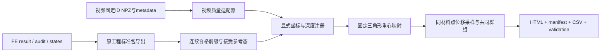

# 共同观测接口

## 所有权和流程

视频算法由 `projects/rec_inc_soft_cut` 管理，完整体 FE 由 `projects/softmodeling` 管理。统一层只读已有结果，以新目录输出派生比较。CLI 与桌面界面共用 `softcut_solution.api`，不会分别实现第二套计算规则。

## 视频输入

优先接入 `results/20261024_n_group_first_1mm/<case>/` 的 `material_displacements.npz` 与 `metadata.json`，目前有 1014n33a1、1014n57a1。所有 NPZ 用 `allow_pickle=False`；原生字段不改名。

| 量 | 字段 |
|---|---|
| 帧与身份 | `source_frames`, `avi_source_frames`, `point_ids` |
| 接触参考位置 | `contact_image_xright_yup_mm` |
| 参考态后位移 | `displacement_from_contact_xright_yup_mm` |
| 条件刀具行程 | `indentation_estimate_mm` |
| 采集时间依据 | `capture_time_from_contact_s`，不与播放时间混用 |
| 端点支持 | `displacement_endpoint_supported` |
| 连续支持 | `all_intermediate_measurement_supported` |
| 身份异常 | `tracker_inferred`, `tracker_ambiguous`, `tracker_blade_occluded` |

`bad = inferred OR ambiguous OR occluded`。端点有效要求端点支持、当前与参考均非 bad、有限参考与当前位移。连续有效要求全历史测量支持且从参考到当前无 bad；具体共同群组固定于所选比较窗口。原始帧顺序保留，包括图像深度轻微非单调。

适配器另外能摘要读取旧 exchange CSV（按 metadata.files 解析）和 MMT/OBT 曲线。旧分段 ID、旧接触地址零点不能直接拼入新固定 ID 位移比较；这些摘要不代表已经实施跨家族定量融合。

## 有限元输入

采用 `softcut-result/1`。`series.qualified` 为已有独立审查的连续前缀；不从 `raw_*` 恢复被屏蔽量。`mesh.reference_positions` 是未变形构型，比较参考采用指定的 `frames.positions` 接受态。`frames.index` 对应原接受态编号。

公共坐标 `[y,z]` 为右/上，mm；`fy_N` 对应求解器 x，`fz_N` 为竖直向上反力。旧基线缺横向力时保持 null。保存帧之间的深度插值是观测采样，不是新的平衡态，不能用于新时刻能量审查；报告记录左右态和权重。

## 显式比较配置

`configs/comparison.example.json` 提供 `registration`、`rotation_deg`、`translation_y_mm/translation_z_mm`、`depth_offset_mm`、`max_depth_mm`、`fe_reference_index`、`support_mode`、`intact_status`。

`tip_translation` 按源 metadata 的图像原点与比例尺把视频参考刀尖转换为图像毫米，再平移到 FE 接受参考态刀尖。它属于条件注册；不以 FE 最佳拟合调整尺度、平移或角度。`explicit` 使用明确给出的平移量。旋转作用于参考位置和位移，单位为度，逆时针为正。深度偏置和坐标平移分别记录，不相互推断。

固定参考材料点在接受态三角形内求一次重心权重，后续预测为同权重的节点位置增量。域外、非有限、资格中断及超出保存帧范围保留缺失，不做外推。连续模式固定窗口共同 ID；端点模式允许有效 ID 改变，报告保留对应计数，不能把它解释为固定群组的历史。

参考深度必须满足“视频第 0 帧深度 + depth_offset_mm = 所选 FE 接受参考态深度”；非零偏置需同时选择正确的已导出 FE 参考态。首次超过分析截止或退出 FE 合格保存范围后，后续帧保留为 `after_cutoff`，不因深度回落重新进入统计。窗口内部的小幅非单调仍按采集顺序保存。

机械首触、实验室标定和裂纹状态未经独立确认时分别保留 conditional/unknown；起裂未知不会自动变为“完整无裂”。默认比较窗口 1 mm 只是用户选择的分析范围。

## 输出与扩展

输出 `softcut-comparison/1`：`manifest.json` 记录来源哈希、单位、注册、算法与资格；`frames.csv` 保留源轴及 FE 采样信息；`points.csv`、`mapping.csv`、`cohorts.csv` 保存身份与固定映射；`observables.csv` 保存共同位移、误差和覆盖；`validation.json` 区分接口一致性与物理精度；`index.html` 提供曲线及导出链接。逐点数据的实际文件名以 manifest 为准。

目前范围是共同材料点位移接口。仿真原工作台提供力/场/接触/能量浏览。后续同标距应变、ΔL、共同表面地址、力—视频同步应各自新增观测算子及测试，不能仅更换标题冒充完成。
