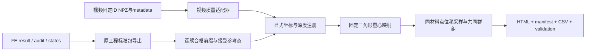

# 共同观测接口

## 所有权和流程

视频算法由 `projects/rec_inc_soft_cut` 管理，完整体与受限裂后 FE 由 `projects/softmodeling` 管理。共同观测比较只读已有结果，以新目录输出派生比较；起裂诊断与裂后求解通过单独的显式动作进入复制 FE 工程。CLI 与桌面界面共用 `softcut_solution.api`，不会分别实现第二套计算规则。

## 视频输入

优先接入 `results/20261024_n_group_first_1mm/<case>/` 的 `material_displacements.npz` 与 `metadata.json`，目前有 1014n33a1、1014n57a1。所有 NPZ 用 `allow_pickle=False`；原生字段不改名。

| 量 | 字段 |
|---|---|
| 帧与身份 | `source_frames`, `avi_source_frames`, `point_ids` |
| 接触参考位置 | `contact_image_xright_yup_mm` |
| 参考态后位移 | `displacement_from_contact_xright_yup_mm` |
| 条件刀具行程 | `indentation_estimate_mm` |
| 采集时间依据 | `capture_time_from_contact_s`，不与播放时间混用 |
| 端点支持 | `displacement_endpoint_supported` |
| 连续支持 | `all_intermediate_measurement_supported` |
| 身份异常 | `tracker_inferred`, `tracker_ambiguous`, `tracker_blade_occluded` |

`bad = inferred OR ambiguous OR occluded`。端点有效要求端点支持、当前与参考均非 bad、有限参考与当前位移。连续有效要求全历史测量支持且从参考到当前无 bad；具体共同群组固定于所选比较窗口。原始帧顺序保留，包括图像深度轻微非单调。

适配器另外能摘要读取旧 exchange CSV（按 metadata.files 解析）和 MMT/OBT 曲线。旧分段 ID、旧接触地址零点不能直接拼入新固定 ID 位移比较；这些摘要不代表已经实施跨家族定量融合。

## 有限元输入

采用 `softcut-result/1`。`series.qualified` 为已有独立审查的连续前缀；不从 `raw_*` 恢复被屏蔽量。`mesh.reference_positions` 是未变形构型，比较参考采用指定的 `frames.positions` 接受态。`frames.index` 对应原接受态编号。

公共坐标 `[y,z]` 为右/上，mm；`fy_N` 对应求解器 x，`fz_N` 为竖直向上反力。旧基线缺横向力时保持 null。保存帧之间的深度插值是观测采样，不是新的平衡态，不能用于新时刻能量审查；报告记录左右态和权重。

## 显式比较配置

`configs/comparison.example.json` 提供 `registration`、`rotation_deg`、`translation_y_mm/translation_z_mm`、`depth_offset_mm`、`max_depth_mm`、`fe_reference_index`、`support_mode`、`intact_status`。

`tip_translation` 按源 metadata 的图像原点与比例尺把视频参考刀尖转换为图像毫米，再平移到 FE 接受参考态刀尖。它属于条件注册；不以 FE 最佳拟合调整尺度、平移或角度。`explicit` 使用明确给出的平移量。旋转作用于参考位置和位移，单位为度，逆时针为正。深度偏置和坐标平移分别记录，不相互推断。

固定参考材料点在接受态三角形内求一次重心权重，后续预测为同权重的节点位置增量。域外、非有限、资格中断及超出保存帧范围保留缺失，不做外推。连续模式固定窗口共同 ID；端点模式允许有效 ID 改变，报告保留对应计数，不能把它解释为固定群组的历史。

参考深度必须满足“视频第 0 帧深度 + depth_offset_mm = 所选 FE 接受参考态深度”；非零偏置需同时选择正确的已导出 FE 参考态。首次超过分析截止或退出 FE 合格保存范围后，后续帧保留为 `after_cutoff`，不因深度回落重新进入统计。窗口内部的小幅非单调仍按采集顺序保存。

机械首触、实验室标定和裂纹状态未经独立确认时分别保留 conditional/unknown；起裂未知不会自动变为“完整无裂”。默认比较窗口 1 mm 只是用户选择的分析范围。

## 输出与扩展

输出 `softcut-comparison/1`：`manifest.json` 记录来源哈希、单位、注册、算法与资格；`frames.csv` 保留源轴及 FE 采样信息；`points.csv`、`mapping.csv`、`cohorts.csv` 保存身份与固定映射；`observables.csv` 保存共同位移、误差和覆盖；`validation.json` 区分接口一致性与物理精度；`index.html` 提供曲线及导出链接。逐点数据的实际文件名以 manifest 为准。

目前范围是共同材料点位移接口。仿真原工作台提供力/场/接触/能量浏览。后续同标距应变、ΔL、共同表面地址、力—视频同步应各自新增观测算子及测试，不能仅更换标题冒充完成。

## 起裂与裂后研究接口（2026-10-28）

两条新流程与 `softcut-comparison/1` 分开。它们不会自动改变视频的裂纹资格，也不会把求解结束改写为实验验证。

| 统一调用 | FE 子进程入口 | 输入约束 |
|---|---|---|
| `fracture_onset(root, cases, length_mm=.15, threshold_mpa=None, seconds=300)` | `python -m tools.fracture_onset --case PATH ... --output PATH --length-mm VALUE --seconds VALUE [--threshold-mpa VALUE]` | 保存的完整体算例位于复制 FE 工程 `outputs/`，具有 result/audit/states；阈值可缺失；不加载新增量 |
| `fracture_run(root, config, seconds=300)` | `python -m tools.run_cohesive_cut --config PATH --output PATH --seconds VALUE` | 总工作区内的 JSON 配置；当前 schema 为 `softcut-cohesive/1`，仅支持 0°、0.2 mm/s 的示例机制模型 |

路径解析后检查范围；不接受原始工程作为写入目标。调用使用参数列表、复制 FE 工作目录与登记解释器。`seconds` 是 1–3600 的整数，统一进程监督超时为 `seconds+60`。每次生成唯一 `runs/<作业>/`：外层 `job.json` 记录命令、解释器、时间、状态、预算、输入/入口哈希，`process.log` 保存子进程输出，`artifact.json` 指向新建 `result/index.html`。研究资产页递归发现本地报告；构建界面不启动求解。

### 完整体诊断输出

`onset_summary.json` 使用 `softcut-onset-summary/1`；每个子目录的 `onset.json` 使用 `softcut-onset/1`，同时输出 CSV、场快照和 HTML。每个已接受状态重新核对保存态哈希、储能和最小 J，仅采用原审查的连续前缀。

事件状态明确区分 `missing_threshold`、`crossed`、`already_above_at_first_qualified_state`、`not_triggered_in_qualified_range`、`censored_by_qualification`。`crossed` 保存前后接受态索引、行程/反力区间、参考位置及局部方向。局部方向是获选单元的方向，不能当成平均场预测的裂纹路径。初态已超阈时下界未知，不能补成 0 mm。示例阈值保持 `calibrated=false`。

### 裂后计算输出

`result.json` 使用 `schema=softcut-cohesive-result/1`，记录配置、示例参数状态、假设、事件、源代码哈希、接受步、失败尝试及能量分账；`audit.json` 保存独立重算审查，`states/` 保存材料和内聚历史，`curves.csv` 与 HTML 展示接受前缀。具体文件以本次结果为准，未产生审查或未完成的运行不能补造通过状态。

当前模型采用有限参考间距，内聚张开为当前节点对距离减参考距离，参考间距不计损伤。两张接缝面始终接入 IPC/CCD。该径向律没有独立的混合模式强度，预设参考路径不能算作预测。模型完成、数值审查、空间/时间细化和实验标定是不同状态；任一已接受的键损伤不能直接写入视频 `intact_status`。

这些输出尚未作为 `softcut-result/1` 裂后观测适配器发布，不直接接入现有完整体—视频位移比较器。完整体导出器和起裂诊断入口均拒绝耦合损伤历史，资产列表也将其排除在完整体候选之外。后续必须明确裂面拓扑、材料点所在侧、失效点支持和裂后资格，才能建立跨模型的共同观测。

### 实验标签与对照

`softcut-fracture-labels/1` 目录保留 `trial_id`、`event_kind`、`depth_reference`、观测区间、证据和 `split`。`tools.fracture_labels.compare_event` 只在身份、参考与事件定义可比时计算区间重叠和有符号间隔；不自动改试次、调整深度、用区间中点取代不确定性或把没有事件视作零误差。物理起裂、可见张开、力趋势代理和分析截止始终分开。当前示例目录全部为 `unused`，已核实且可用于物理起裂标定的标签为 0。

模型公式、文献、运行状态与下一步验证见 [起裂与裂后实现说明](fracture_implementation.md)。
