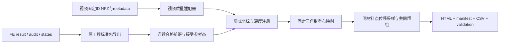

# 共同观测接口

## 所有权和流程

视频算法由 `projects/rec_inc_soft_cut` 管理，完整体与受限裂后 FE 由 `projects/softmodeling` 管理。共同观测比较只读已有结果，以新目录输出派生比较；起裂诊断与裂后求解通过单独的显式动作进入复制 FE 工程。CLI 与桌面界面共用 `softcut_solution.api`，不会分别实现第二套计算规则。

## 视频输入

优先接入 `results/20261024_n_group_first_1mm/<case>/` 的 `material_displacements.npz` 与 `metadata.json`，目前有 1014n33a1、1014n57a1。所有 NPZ 用 `allow_pickle=False`；原生字段不改名。

| 量 | 字段 |
|---|---|
| 帧与身份 | `source_frames`, `avi_source_frames`, `point_ids` |
| 接触参考位置 | `contact_image_xright_yup_mm` |
| 参考态后位移 | `displacement_from_contact_xright_yup_mm` |
| 条件刀具行程 | `indentation_estimate_mm` |
| 采集时间依据 | `capture_time_from_contact_s`，不与播放时间混用 |
| 端点支持 | `displacement_endpoint_supported` |
| 连续支持 | `all_intermediate_measurement_supported` |
| 身份异常 | `tracker_inferred`, `tracker_ambiguous`, `tracker_blade_occluded` |

`bad = inferred OR ambiguous OR occluded`。端点有效要求端点支持、当前与参考均非 bad、有限参考与当前位移。连续有效要求全历史测量支持且从参考到当前无 bad；具体共同群组固定于所选比较窗口。原始帧顺序保留，包括图像深度轻微非单调。

适配器另外能摘要读取旧 exchange CSV（按 metadata.files 解析）和 MMT/OBT 曲线。旧分段 ID、旧接触地址零点不能直接拼入新固定 ID 位移比较；这些摘要不代表已经实施跨家族定量融合。

## 有限元输入

采用 `softcut-result/1`。`series.qualified` 为已有独立审查的连续前缀；不从 `raw_*` 恢复被屏蔽量。`mesh.reference_positions` 是未变形构型，比较参考采用指定的 `frames.positions` 接受态。`frames.index` 对应原接受态编号。

公共坐标 `[y,z]` 为右/上，mm；`fy_N` 对应求解器 x，`fz_N` 为竖直向上反力。旧基线缺横向力时保持 null。保存帧之间的深度插值是观测采样，不是新的平衡态，不能用于新时刻能量审查；报告记录左右态和权重。

## 显式比较配置

`configs/comparison.example.json` 提供 `registration`、`rotation_deg`、`translation_y_mm/translation_z_mm`、`depth_offset_mm`、`max_depth_mm`、`fe_reference_index`、`support_mode`、`intact_status`。

`tip_translation` 按源 metadata 的图像原点与比例尺把视频参考刀尖转换为图像毫米，再平移到 FE 接受参考态刀尖。它属于条件注册；不以 FE 最佳拟合调整尺度、平移或角度。`explicit` 使用明确给出的平移量。旋转作用于参考位置和位移，单位为度，逆时针为正。深度偏置和坐标平移分别记录，不相互推断。

固定参考材料点在接受态三角形内求一次重心权重，后续预测为同权重的节点位置增量。域外、非有限、资格中断及超出保存帧范围保留缺失，不做外推。连续模式固定窗口共同 ID；端点模式允许有效 ID 改变，报告保留对应计数，不能把它解释为固定群组的历史。

参考深度必须满足“视频第 0 帧深度 + depth_offset_mm = 所选 FE 接受参考态深度”；非零偏置需同时选择正确的已导出 FE 参考态。首次超过分析截止或退出 FE 合格保存范围后，后续帧保留为 `after_cutoff`，不因深度回落重新进入统计。窗口内部的小幅非单调仍按采集顺序保存。

机械首触、实验室标定和裂纹状态未经独立确认时分别保留 conditional/unknown；起裂未知不会自动变为“完整无裂”。默认比较窗口 1 mm 只是用户选择的分析范围。

## 输出与扩展

输出 `softcut-comparison/1`：`manifest.json` 记录来源哈希、单位、注册、算法与资格；`frames.csv` 保留源轴及 FE 采样信息；`points.csv`、`mapping.csv`、`cohorts.csv` 保存身份与固定映射；`observables.csv` 保存共同位移、误差和覆盖；`validation.json` 区分接口一致性与物理精度；`index.html` 提供曲线及导出链接。逐点数据的实际文件名以 manifest 为准。

目前范围是共同材料点位移接口。仿真原工作台提供力/场/接触/能量浏览。后续同标距应变、ΔL、共同表面地址、力—视频同步应各自新增观测算子及测试，不能仅更换标题冒充完成。

## 起裂与裂后研究接口（2026-10-28）

两条新流程与 `softcut-comparison/1` 分开。它们不会自动改变视频的裂纹资格，也不会把求解结束改写为实验验证。

| 统一调用 | FE 子进程入口 | 输入约束 |
|---|---|---|
| `fracture_onset(root, cases, length_mm=.15, threshold_mpa=None, seconds=300)` | `python -m tools.fracture_onset --case PATH ... --output PATH --length-mm VALUE --seconds VALUE [--threshold-mpa VALUE]` | 保存的完整体算例位于复制 FE 工程 `outputs/`，具有 result/audit/states；阈值可缺失；不加载新增量 |
| `fracture_run(root, config, seconds=300)` | `python -m tools.run_cohesive_cut --config PATH --output PATH --seconds VALUE` | 工作区内 JSON；`softcut-cohesive/1` 保留0°径向示例；`softcut-cohesive/2` 为显式混合模式，角度[0,90)、0.2 mm/s、行程≤2 mm，选择预设接缝或全内部边网络 |

路径解析后检查范围；不接受原始工程作为写入目标。调用使用参数列表、复制 FE 工作目录与登记解释器。`seconds` 是 1–3600 的整数，统一进程监督超时为 `seconds+60`。每次生成唯一 `runs/<作业>/`：外层 `job.json` 记录命令、解释器、时间、状态、预算、输入/入口哈希，`process.log` 保存子进程输出，`artifact.json` 指向新建 `result/index.html`。研究资产页递归发现本地报告；构建界面不启动求解。

### 完整体诊断输出

`onset_summary.json` 使用 `softcut-onset-summary/1`；每个子目录的 `onset.json` 使用 `softcut-onset/1`，同时输出 CSV、场快照和 HTML。每个已接受状态重新核对保存态哈希、储能和最小 J，仅采用原审查的连续前缀。

事件状态明确区分 `missing_threshold`、`crossed`、`already_above_at_first_qualified_state`、`not_triggered_in_qualified_range`、`censored_by_qualification`。`crossed` 保存前后接受态索引、行程/反力区间、参考位置及局部方向。局部方向是获选单元的方向，不能当成平均场预测的裂纹路径。初态已超阈时下界未知，不能补成 0 mm。示例阈值保持 `calibrated=false`。

### 裂后计算输出

`result.json` 使用 `schema=softcut-cohesive-result/1`，记录配置、示例参数状态、假设、事件、源代码哈希、接受步、失败尝试及能量分账；`audit.json` 保存独立重算审查，`states/` 保存材料和内聚历史，`curves.csv` 与 HTML 展示接受前缀。具体文件以本次结果为准，未产生审查或未完成的运行不能补造通过状态。

当前模型采用有限参考间距，内聚张开为当前节点对距离减参考距离，参考间距不计损伤。两张接缝面始终接入 IPC/CCD。该径向律没有独立的混合模式强度，预设参考路径不能算作预测。模型完成、数值审查、空间/时间细化和实验标定是不同状态；任一已接受的键损伤不能直接写入视频 `intact_status`。

新 `softcut-cohesive/2` 要求 `cohesive_kind=mixed_mode_energy`、`fracture_topology=prescribed_seam|edge_network` 和 `no_experimental_force_fitting=true`，四个物性及损伤开关必须显式给出；共同Gc限制与Ks的派生关系保留在输出。网络另声明正的 `network_metric_floor_n_per_mm`，只作用于PTC方向度量，不增加物理力、储能或耗散；显式 `network_predictor=body_stationary_if_safe|baseline` 控制初值。前者先尝试保持材料上一接受位置、移动刀具，完整CCD/J检查不通过则回退原仿射初值；不改物理时间、残量或接受标准。输出继续使用 `softcut-cohesive-result/1` 并记录配置版本、拓扑、求解策略、参考面积、面积损失和源码哈希。

新检查点的 `cohesive_maximum` 为 `[界面段数,2]`，与 `interface_segments` 四节点、逐Gauss参考法向间隙/切向偏置绑定；不能读作旧径向节点历史。完整失效段要求两个Gauss点均完全失效，事件名为 `first_fully_separated_segment`；保存段/积分点编号和参考/当前位置。网络连通长度是与原外表面连通的失效原边总长，可含分叉；它不是竖直裂深。旧 `*_bonds` 计数字段在混合分支仅作段计数兼容别名，明确标注。全过程能量余项及数值路径审查各有资格，2%余项诊断线不是模型通过网格收敛或实验验证的声明。

`softcut-cohesive/3` 新增显式有限间隙闭合正则化：`closure_regularization=reversible_compression_penalty`、正的 `cohesive.compression_stiffness_mpa_per_mm`、固定 `preparation_clearance_mm`、`minimum_increment_mm` 及 `ccd_tolerance_mm`。后者不超过原生默认1e-6 mm，且不超过间隙及dhat的十分之一；只收紧完整CCD精度。准备净空是竖直行程定义，所有物理时间仍按实际行程/速度推进。旧版本不隐式启用压缩项或自定义最小步。网络可显式选择 `safe_affine_blend`，在刀具精确达到目标位置的候选中，以完整CCD/J、边界和新鲜残量选择安全的材料初猜；原affine重试继续保留。

新输出的 `compression_stored_energy_n_mm` 与 `damageable_stored_energy_n_mm` 加和等于原 `cohesive_stored_energy_n_mm`；能量账使用总量一次，不把可恢复压缩功计入Gc。压缩从参考正间隙开始且完全损伤后仍保留，与IPC法向力相加；现摩擦仅基于IPC法向载荷。`compression_internal_force_norm_n` 是全体节点内力范数，不是刀具反力或法向载荷份额。`regularization_scales` 中尺度比只作诊断，不能代替柔度、网格及间隙验证。缺失的载荷分担保持null。

网络可显式设 `ptc_model_backtracks`（整数0–30，默认0）。它只在原PTC候选未通过局部力模型检查时，沿已经通过CCD/J的同一方向减半数值步长，再以新鲜接触/摩擦残量检验原判据。失败后才回到原增大shift流程；18次方向重试、500次迭代、墙钟、物理时间与最终残量均保持。该数值缩步不是新的物理加载态，不提交材料或损伤历史。

版本3的 `bounded_reversible_compression_penalty` 模式额外强制 `cohesive.compression_regularization_mm=reference_gap_mm`；该派生长度不能单独拟合。它保留近零Kc切线，同时将配对本构法向压力限制在Kc乘该长度以内，防止已经远滑开的失效配对产生无界虚拟压力。旧线性模式要求该字段缺失或null。gap控制族仅允许这一强制派生字段随gap联动，仍固定dhat、CCD和其他物性。实际牵引上界不等于总接触力或摩擦误差界。

`tools.verify_network_compliance` 是独立无损伤弹性patch验证，不是刀切。`tools.verify_network_sensitivity` 的 `template` 仅生成清单、`compare` 只读保存证据、`runstudy` 才按清单逐例有界求解。控制族仅允许声明的网格/间隙/刚度/时间等轴变化；材料、强度、Gc、摩擦、准备净空等保持。未完成目标、缺审计、哈希不符或近零参考力一律保留inconclusive，不能靠裁短共同前缀认证完整行程。两两差异可用不代表收敛通过，能量资格也不由比较器自动升级。

这些输出尚未作为 `softcut-result/1` 裂后观测适配器发布，不直接接入现有完整体—视频位移比较器。完整体导出器和起裂诊断入口均拒绝耦合损伤历史，资产列表也将其排除在完整体候选之外。后续必须明确裂面拓扑、材料点所在侧、失效点支持和裂后资格，才能建立跨模型的共同观测。

### 实验标签与对照

`softcut-fracture-labels/1` 目录保留 `trial_id`、`event_kind`、`depth_reference`、观测区间、证据和 `split`。`tools.fracture_labels.compare_event` 只在身份、参考与事件定义可比时计算区间重叠和有符号间隔；不自动改试次、调整深度、用区间中点取代不确定性或把没有事件视作零误差。物理起裂、可见张开、力趋势代理和分析截止始终分开。当前示例目录全部为 `unused`，已核实且可用于物理起裂标定的标签为 0。

新增 `right_censored_observation` 表示观察窗口内未裂，使用 `censoring=right`、`lower_bound_mm`、`bound_relation=strictly_greater`、`depth_interval_mm=null`，不能进入 calibration。用户报告的57°重复试验截至2 mm未裂按 `observation_scope=condition` 保存，`trial_id=null`，具体次数/编号不补造；这是一条已接受的用户报告约束，独立图像/时钟核查状态另列。条件级比较必须显式指认 `condition_constraint_id` 与 `condition_id`；深度参考尚未注册时必须声明 `depth_reference_assumption`，结果保留条件性，不能冒充逐试次验证。输出 `contradicted/consistent/unresolved`。未触发路径另需 `qualified_no_event_history={depth_interval_mm:[start,end], continuous:true, from_initial_intact_state:true}`，沿用预测的同一深度参考；声明的连续合格无事件区间必须覆盖观察下限，不能只因末态深度足够就把晚开始片段或资格中断当未裂。事件区间按保守闭区间处理，`[2,2.01]` 对严格 `d_c>2` 仍为 unresolved。此接口只检验给定预测，不选取或反演阈值。

模型公式、文献、运行状态与下一步验证见 [起裂与裂后实现说明](fracture_implementation.md)。

版本3可选 `ptc_residual_guard` 为布尔值，默认false；true要求正的`ptc_model_backtracks`并仅用于全边网络。在原模型误差门之外叠加新鲜残差平方的Armijo下降门（c=1e-4），不含旧残差merit后备的10%固定下降要求；控制迭代过程，不替代最终1e-4 N验收。此严格策略仍可能停滞，必须报告实际验证，不自动认证完整切割。历史检查点绑定该开关。

版本3的`mesh.fine_halfwidth_mm`为可选正有限值，省略保留原3 mm。它只设置已有graded网格刀尖细化区域的半宽，实际mesh/hash随几何保存；同一尺寸敏感性族需固定它，不能把外围改变隐藏为纯表面细化。准备净空、速度、材料时间、刀尖半径与刀鼻面片数仍单独固定。

版本3可选 `ptc_shift_policy=residual_ratio|backtrack_aware`，默认前者；后者要求正`ptc_model_backtracks`并仅在网络启用。它读取已接受方向的额外模型回溯次数调整下一次PTC移位，几何初始截步本身不触发；独立于`ptc_residual_guard`。配置、接受记录和检查点绑定策略，不允许跨策略直接恢复。原物理方程、500次迭代与残量门槛不变。

版本3另提供显式研究模式 `closure_regularization=finite_face_bounded_compression_penalty`，必须配合 `cohesive.compression_kinematics=finite_faces` 及 `compression_regularization_mm=reference_gap_mm`。它保留混合损伤的共转张开/滑移定义，单独将可恢复闭合势改为两侧各两个Gauss点到对侧**有限线段**的最近距离；参考距离在自身未变形网格计算，并以 `reference_closure_distances_mm` 写入检查点、恢复与独立审查。力与切线包含最近点位置/方向变化的导数，双侧各半权重，不重复计入压缩能或Gc。

该模式在真实有限面距离超过全部参考闭合距离时具有严格为零的压缩能和节点力。失效不触发删除力或能量；近距离闭合势在完全失效后仍保留。它仍是有限间隙数值补偿，激活范围可能大于IPC的dhat，不能因此称为物理接触已收敛；IPC/CCD、自接触和既有摩擦定义全部保留，摩擦法向载荷仍只来自IPC。新旧模式有不同的物理签名，禁止移植旧历史。原默认配置不隐式迁移；`fracture_network_finite_faces.json`是独立研究配置。

纯界面响应在 `finite_faces` 模式下，`traction/tangent` 表示可损伤的共转分量，完整压缩积分点响应位于 `finite_face_closure`；`compression_traction`仅为双侧平均诊断量。真正参与平衡的是总`gradient/hessian`，能量使用总`stored_energy_n_mm`一次。配对审计区分超出IPC激活距离与超出数值闭合支持范围，两者不能互换。

`tools.verify_cutting_compliance --front-diagnostic`显式扩展无损伤诊断目标至0.5 mm，默认仍限制0.05 mm。这个开关只用于分辨离散/接触与损伤效应，不声明实验在该窗口未裂。每个算例从自身初态加载、预算独立、目标完成和逐态审查仍是定量比较门槛。

### 断裂专项研究接口（2026-10-28）

FE版本3可显式声明`nonlinear_solver="newton_lm"`，缺省仍为`ptc`；非缺省求解器写入检查点并核查身份。该选项不改变力容差、CCD、物理时间、材料或损伤历史，不自动出现在桌面默认工况。零间隙拓扑和标量动力学仅为可验证研究内核，未提供虚假的生产切割运行入口。独立验证输出`softcut-fracture-resolution/1`，逐步能量后处理输出`softcut-fracture-energy-screen/1`；它们的`full_cutting_qualified`/`physical_evolution_qualified`保持false。`softcut-independent-fracture-plan/1`是待执行试验计划，null和空证据不能提升为物性。
