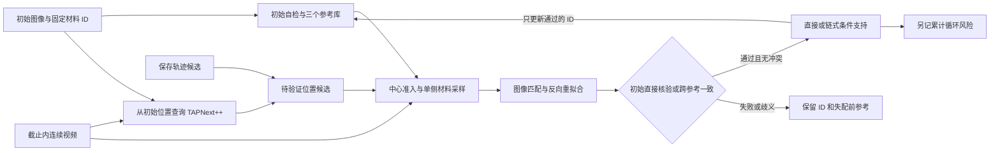

# 近表面材料身份：边界支持与初始参考连接优化

日期：2026-10-25。本文记录问题定位、实现选择与验收，不把方案设计写成已经证明的精度提升。前一轮方法见[四模块说明](reliable_pipeline_methods.md)，基础文献见[导读](../reference/READING_GUIDE.md)。本轮复用材料仿射匹配核、预训练网络和既有图像，不训练模型，不修改接触零点、起裂截止或历史滑移曲线。

## 1. 这次具体修什么

上一轮 240 个点次中，测量层受支持 232 个。余下 8 个中，7 个在原始跟踪层仍受支持；全部 8 个被向内收缩后的材料掩膜排除。CoTracker3 的 3 个候选、TAPNext++ 的 1 个候选位于未收缩材料区，但仍被收缩规则排除。这说明“测量层未采用”与“材料身份已经跟丢”混在了一起，原来的恢复计数不能代表长期丢点后的恢复能力。

原边界方案的近期匹配通过 226/240、初始匹配通过 32/240、二者位置一致 20/240。直接把初始纹理用一个仿射块匹配到深度较大的图像，是需要检验的瓶颈；这些数字尚不能区分仿射表达不足、光学纹理变化、原轨迹漂移和真实遮挡。原网络查询取自近期旧轨迹，也可能继承旧身份错误。

因此，本轮把三件事分别检查：**几何中心是否合理、材料纹理是否匹配、匹配身份是否能追溯到初始材料。** 增加其中一种支持，不能自动代替另外两种。

| 障碍 | 改动 | 明确不作出的推论 |
|---|---|---|
| 表面中心被计算梯度所需的掩膜收缩直接删掉 | 中心准入与纹理采样分离，允许受限边界不确定带内的中心由材料一侧纹理支持 | 未投影或吸附中心；不把背景、刀具像素补进材料纹理 |
| 大变形后初始与当前纹理难以直接仿射匹配 | 初始参考固定保留，经受验证的真实关键帧逐段建立身份连接 | 路径连续不等于无累计误差；共享祖先的两条路径不独立 |
| 网络从旧近期位置出发继承漂移 | TAPNext++ 从初始帧原始 ID 查询，处理截止之前的连续前缀 | 网络的可见性仍是预测，不能自动变成材料观测 |
| 只选近期还能跟踪的点，漏掉真正丢失情况 | 固定原始材料 ID 队列，不以当前/近期支持为入选门槛，另保留旧失败 ID 回归集 | 开发集覆盖改善不是独立真实精度验证 |

图中的“通过”还需满足纹理、刀体、数值和单次前后向检查；网络候选没有通往参考更新的旁路。累计循环风险单独记录，不因其随序列长度增加就自动中断参考更新。

## 2. 文献依据与本项目推导的边界

**边界匹配。** Poissant–Barthelat 的 SSDIC 在位移不连续两侧使用不同运动表达，支持“不要混合不同物体运动”的选择；其原算法会排除分割线穿过中心像素的情形。本轮并未复现完整 SSDIC，也没有据此宣称几何边界上的像素一定可测。这里的中心是在有限边界误差内由邻近单侧纹理估计，必须单列为条件支持，并以已知位移、掩膜扰动和刀具亮度反事实检验。[作者全文](https://barthelat-lab.mcgill.ca/files/papers/EM2010.pdf) · [DOI](https://doi.org/10.1007/s11340-009-9220-2)

**大变形参考更新。** Pan、Wu、Xia（2012）在泡沫大压缩实验中采用有条件的参考更新，并指出更新会引入累积误差。它为使用中间参考提供依据，但没有证明多路径就能消除漂移。本轮增加固定初始参考、经过验证才入库、跨参考一致性和错误预算，这些是本项目可检验的工程设计，不称作论文原算法。[出版页](https://doi.org/10.1016/j.optlaseng.2011.05.005) · [全文](https://www.ncorr.com/download/publications/panlargedef.pdf)

**计量约束。** iDICs 2018 第 5.2.1 节、印刷页 54（PDF 第 70 页）区分固定、增量和分段相关，并说明逐段连接仍会累积误差。该具体内容已核对本地第一版；不将未读到的第二版条款当作依据。当前权威新版入口仍保留在文献目录。[第一版本地全文](../reference/papers/idics2018.pdf) · [官方指南入口](https://idics.org/guide/)

**现代网络候选。** 已部署 TAPNext++ 的长时递归跟踪和重检测能力适合提供从原始查询出发的候选。本轮改变的是查询起点和时间范围，没有以网络输出替换材料核验。其自然视频基准不证明润滑、压缩和遮挡下的材料计量精度。[作者项目](https://tap-next-plus-plus.github.io/) · [论文](https://arxiv.org/abs/2604.10582)

方法选择依据是当前失败机制与可验证性，而非年份或网络大小。没有公开资料证明这套组合已经是橡胶刀尖接触测量的 SOTA。

## 3. 中心与纹理支持分开处理

旧设计把同一份收缩掩膜同时用于中心和采样：它能保护梯度模板，却会拒绝真实表面附近的中心。新设计保留两份语义不同的条件：

1. **几何中心条件**：中心可以在原材料掩膜内，或距它不超过声明的像素容差；刀体硬排除仍成立。中心坐标不移动、不投影、不与边缘强行重合。
2. **图像采样条件**：灰度、梯度和插值只用有效材料侧像素，刀具像素始终排除。材料归一化卷积避免背景和亮刀具渗入预处理；梯度模板需要的收缩只作用于采样支持。
3. **匹配条件**：保留纹理量、有效比例、残差、相关性、前后向重新拟合与多候选歧义检查。中心准入放宽不能降低这些图像标准。

若传入单独、明确的刀体内部掩膜，中心与射线可按该内部区域作硬排除，图像采样仍排除完整语义刀具掩膜。未传入时，完整刀具掩膜就是硬排除区域。不能仅凭“中心靠近刀具边缘”把它视为材料。

设参考中心为 \(p\)，当前中心为 \(q\)，局部偏移为 \(\xi\)，则单侧仿射匹配为：

\[
W_{r\to t}(p+\xi)=q+A_{r\to t}\xi,
\qquad E=\sum_{\xi\in\Omega_{r,t}}\rho\left[I_t(W_{r\to t}(p+\xi))-gI_r(p+\xi)-c\right].
\]

\(\Omega_{r,t}\) 仅含两帧有效、未被刀具遮挡的材料采样；\(g,c\) 处理亮度增益和偏置，不能解释任意油液折射。中心在材料支持凸包以外时，求解属于短距离外推；其几何准入状态必须保留，不能与中心内部观测混写。

初始设定的 1.5 px 中心容差是掩膜不确定性工程参数，API 上限 2 px；需要通过掩膜位移测试检查敏感性。它不是测量精度、不是接触间隙物理判据，也不限制累计滑移量。此前 8 px 局部修正范围同样不是微米滑移上限。实现保存两帧中心到材料像素的欧氏距离场双线性采样值，以及 `center_extrapolated`；后者单列条件外推，不省略其状态。该距离是离散像素距离场的插值，不是精确连续轮廓的有符号距离。

新分支要求插值后的采样掩膜值大于 0.999，保护完整梯度与插值邻居；穿刀射线的步距不超过 0.5 px，防止旧的七个离散采样跨过细刀体。原分支的数值行为保留作为对照。

## 4. 从初始材料连接到当前图像

每个 ID 对应固定初始材料位置 \(X_i\)。初始图像不更新；中间参考保存真实图像和已核验位置，不反复重采样生成“合成材料模板”。局部形变按路径复合：

\[
\Phi_{0\to t}=W_{r\to t}\circ\Phi_{0\to r},
\qquad F_{0\to t}=A_{r\to t}F_{0\to r}.
\]

不能平均不同参考的仿射矩阵作为材料形变，也不能仅因预测位置平滑就把它存入参考库。

初始图像上的有效纹理和几何先自检，以此确定可建立身份根的种子；初始失败 ID 仍保留，但不会因后续候选看起来合理而凭空建立根。每一步比较近期有效参考与较早关键帧，并按规定间隔追加初始参考检查。直接参考失败时，可以从两个不同时间、已连接至初始的有效参考分别提出匹配，并检查当前位置相容性。每条边都执行前后向重新拟合；它不是把前向矩阵求逆再宣称闭环成立。存在相近得分但不同位置，或参考路径给出冲突时，保留歧义。

关键帧只更新通过审核的 ID。失败或纯预测行不进入参考库，不会在下一帧变成“可信参考”。失配时保留材料 ID 与失配前参考；以后可重新尝试连接，而不是把另一个纹理点重新命名成原 ID。参考库使用初始、近期和较早关键帧三个有界的逐 ID 图像块集合，避免无限积累图像和参考数量。

初始直接确认、关键帧链条件确认和仅候选必须分开输出。两条路径可能共享图像、祖先、预处理和局部模型，位置一致是检查条件，**不能把路径数量换算为独立置信度**。累计循环残差只是风险指标，不是总位置误差上界；重复纹理、油膜共同漂移等仍可能通过循环检查。

当前默认设置为关键帧最小间隔 12 源帧、初始参考检查间隔 12 源帧、跨参考位置一致阈值 1.5 px。单次前后向误差仍按 0.8 px 检查；累计循环量超过 8 px 只输出风险标记，默认 `cycle_budget_policy='diagnostic'`，`'reject'` 保留作受控消融。直接初始匹配可重置累计量；没有通过或有歧义的参考，即使图像分数很高，也不允许参与位置选择。每个 ID 的形变矩阵单独检查可逆性；坏矩阵只使该 ID 不可用，不能使整组中断，也不把小的累计面积比一概当作数值失败。

### 为什么撤销累计量的硬停止

第一组 n57 的完整硬停止对照中，保存候选分支终末失效的 66 个 ID，有 47 个最后失效段从累计预算拒绝开始；网络候选分支对应为 61 个中的 49 个。拒绝后不再更新参考，旧参考随变形老化，随后表现为相关性不足。不能把这条失败链反过来解释为材料纹理必然已经消失。[逐 ID 诊断](../results/20261025_surface_identity/final/audits/1014n57a1_identity_diagnostics.json)

该累计量叠加了共享图像与祖先路径的前后向残差和参考分歧，误差并不独立；没有统计标定或物理推导证明“总和达到 8 px”就应判定身份失效。它还会随长度增加，导致每步图像仍合格的轨迹被时长本身淘汰。因此修正的是这个指标的作用：**由未经验证的接受条件改为保留的风险诊断**，而不是放宽单次匹配门槛或扩大允许位置误差。

修正后，每条匹配的前后向误差、几何/刀体、纹理、歧义及跨参考一致性标准全部不变。高累计风险下允许继续保存合格图像证据，但仍不宣称准确身份；误差可共同漂移的限制继续存在。另用连续小残差且真实图像持续支持的序列检查不会被强制停链，同时保留旧拒绝模式作消融。两组已完成的硬停止对照和其运行源码保持原样，新五组复测写入 `results/20261025_surface_identity/validated/`，不把两种策略混合统计。

输出中的 `root_confirmed` 只表示直接初始图像核验，`rooted_conditional` 表示经中间参考连接；二者都不是物理身份真值。`reference_failure_flags` 汇总该参考所有候选、所有邻域尺寸的失败位，**不是互斥的最终失败归因**：某一候选失败后，另一候选仍可能通过。该参考最终是否通过须读取 `reference_accepted`。

**未枚举的重复纹理仍可产生错误身份。** 在严格静止、横向周期 12 px 的合成纹理中，只提供偏移 12 px 的错误候选，结果仍可通过 `root_confirmed`，而循环残差为 0。相同纹理的别名没有被其他候选揭示，前后向匹配不能识别这种身份错误。因此多候选检查只覆盖实际枚举的竞争解，8 px 循环预算绝不是位置误差上界。这是可辨识性负例，不表示真实橡胶误差就是 12 px。[完整反例](../results/20261025_surface_identity/final/audits/periodic_identity_counterexample.json)

## 5. 网络改为原始查询，而非旧轨迹查询

从初始帧 \(t=0\) 的 \(X_i\) 建立查询，输入该视频至声明截止帧的连续图像。TAPNext++ 在本地逐帧运行；不使用截止之后或断裂后图像去反推此前身份。旧轨迹可作为另一个待拒绝的数值初值，但不充当网络查询身份或正确性真值。

输出保留网络原位置、可见性、图像验证结果、参考路径和拒绝原因。网络候选即使落入材料区、两次预测一致或看起来平滑，也不自动增加观测数。初始查询帧被网络固定的位置不能用来证明准确。

前缀推理和关键帧图像核验分别计时，记录实际送入模型的图像尺寸、源帧编号、查询 ID、模型版本与权重哈希。缩小全图可能损失刀尖细纹理，因此需要在结果中明确原图与模型的尺度；不能把执行成功写成原图像素级精度已保证。

## 6. 评价队列、状态与验收

固定队列依据初始表面材料身份和声明的几何范围构建，不以目标帧或近期帧是否受支持为入选条件。原来的 8 个失败点次另作固定回归子集；新旧队列不同则分别报告分母，不能直接把两个总通过率作优劣判断。

| 输出状态 | 回答的问题 | 不能混同为 |
|---|---|---|
| 原跟踪层支持 | 原材料跟踪器在这一帧是否通过自己的图像判据 | 当前测量是否采用、身份绝对正确 |
| 原测量层支持 | 后处理测量是否采用该轨迹 | 跟踪器是否已经丢点 |
| 原始直接核验 | 初始图像到当前是否通过本轮图像检查 | 单目物理真值 |
| 初始连接链核验 | 当前结果是否经合格参考路径接回原始 ID | 无漂移保证或独立证据融合 |
| 缺测后恢复 | 某 ID 此前失配，之后重新满足指定身份规则 | 缺测期间的位置已经观测到 |
| 边界条件支持 | 几何中心靠边，由单侧材料纹理支持 | 中心像素本身具有完整材料纹理 |
| 累计循环风险 `cycle_budget_exceeded` | 累加诊断量是否超过声明的 8 px 参考值 | 已测位置误差大于 8 px，或默认必须丢点 |
| 网络候选、未核验或歧义 | 有待审核坐标，或存在冲突解释 | 实测材料点或零速度 |

合成测试必须同时包含正例和拒绝例：已知平移/旋转/拉伸剪切、逐渐变形、错误候选、周期纹理歧义、缺帧/遮挡后重现、刀具内部与穿刀射线、边界移动和外部亮度改变。另检查固定 ID 顺序、严格递增源帧、截止不泄漏、失败不更新参考以及有限内存。只测试函数返回形状不构成测量验证。

真实开发视频至少报告：总队列、原跟踪/测量支持、直接/链式支持、两类缺测恢复、边界准入、拒绝类别、刀体侵入、路径分歧及运行成本。真实视频没有逐点真值时，将新增项称为“条件图像支持”，不称为确认正确的物理恢复。是否升级默认方案，还需独立可见纹理人工复核和未用于开发的片段，不能用显微镜目标或强制滑移平台调出通过结果。

## 7. 实施决策记录

| 时间 | 证据或决策 | 后果 |
|---|---|---|
| 2026-10-25，逐点复核 | 8 个测量失败点次大多仍有原跟踪支持；所有点受中心收缩规则影响 | 先分离跟踪失败与测量过滤，不把“零新增”归因为网络能力不足 |
| 2026-10-25，设计冻结 | 中心准入、单侧采样、初始连接、原始网络查询分别消融 | 复用匹配核；新能力显式开启；不覆盖历史结果 |
| 2026-10-25，验证范围 | 五组开发视频的初始至 1 mm 前缀，包含旧失败 ID；不使用截止之后图像 | 这一范围用于机制排查，不能替代三毫米全程和新工况精度验收 |
| 2026-10-25，模块核验 | 边界、错误纹理、细刀体、跨 ID 图像块、缺测恢复和数值失效隔离测试通过 | 允许进入真实视频验证，不将合成结果当真实橡胶精度 |
| 2026-10-25，首轮复测中止 | 发现被拒绝或有歧义的参考仍可能凭高分影响位置选择 | 明确把拒绝参考的排序分数置为负无穷；新增高分错误参考回归测试；中止输出不作为验收结果 |
| 2026-10-25，计算优化 | 同一帧重复计算材料归一化、梯度和距离场造成额外成本 | 只缓存不变图像与几何准备结果；逐数组等价检查已通过，重新完整复测，不改变验收阈值 |
| 2026-10-25，硬停止机制复核 | n57 多数终末失效从未经标定的累计 8 px 预算拒绝开始，继而参考老化 | 累计量改作风险诊断；逐边和跨参考门槛保留；旧拒绝策略留作消融，新五组完整复测另存 |

强压缩合成检查把横向伸长比逐渐降至 0.16：126 个点次的链式结果全部获得条件支持，最大位置误差 0.205 px；相同终态直接初始匹配的 3 个点均拒绝。该测试向局部求解器提供了真值附近的候选，证明的是连接与核验能够表达这类变形，**不是自动搜索的端到端精度**。实际帧序列还需要另行验收。

### 运行与缓存

统一入口：`python softcut.py optimize --stage identity --config configs/optimization.identity.json --out results/new_surface_identity`；可先加 `--check-only`。本轮配置使用五组历史开发视频的完整初始至 1 mm 前缀，固定队列含旧失败点，不以当前/近期支持筛掉困难 ID。`results/20261025_surface_identity/` 保存运行证据；`final/` 保留硬停止对照及机制诊断，`validated/` 是已完成的正式五组复测，结果见下一节。

`prepare_verification_image` 生成只读准备快照，包含材料归一化图像、梯度、采样支持、刀体屏障和边界距离场。同一当前帧只准备一次，多个参考复用；初始参考不变可长期复用，中间参考有任何图像块或几何更新就使快照失效。缓存不复制另一套匹配器，也不缓存“通过”结论。调用方必须在图像、掩膜或刀体内部改变后重建快照；尺寸相同不代表内容相同。

缓存验收比较准备前后位置、接受状态和诊断数组，另检查输入修改不影响已有只读快照、不兼容模式被拒绝。运行时间单独统计，不靠缩短前缀、跳过坏点或放宽匹配标准提速。正式统计只使用完整复测，不用被中止的输出替代。

最终完整测试为 717 passed，另 3 subtests passed。与基线 `98ec115` 的默认数值对照涵盖六帧已知仿射合成纹理及两种既有核验模式，154 个数组完全一致。这不是实际视频精度检查，也不宣称源码或 AST 未变；新分支另外验证。[默认数值对照](../results/20261025_surface_identity/default_equivalence.json)

n57 的 68 ID、20 帧实际片段中，整条身份链从 4.492 s 降为 3.890 s，约 1.15 倍速度；所有返回数组逐元素一致。[性能及等价记录](../results/20261025_surface_identity/profile_cached.json) 单次核验准备后的复用收益更大，但不能把该微基准当成整批两倍提速。

## 8. 五组完整复测结果

五组共处理 3024 个源帧，覆盖初始至各组 1 mm 前最后一帧；固定队列合计 340 个材料 ID，下压阶段共 139249 个点次。它们仍是历史开发数据，没有独立逐点物理真值。[视频与图表](../results/20261025_surface_identity/validated/index.html) · [运行汇总](../results/20261025_surface_identity/validated/summary.json) · [逐类审计](../results/20261025_surface_identity/validated/audits/identity_diagnostics.json)

3024 帧包含接触前图像。两种身份链分支计时合计 1345.85 s，网络另计 91.73 s；这些计算时间不包含全部报告与视频编码。正式验证检查了 215 个无 pickle 数组包、64 个报告本地链接及运行源码/输入哈希；存量结果检查也通过，原轨迹未被覆盖。

表中 **A → B** 分别为“身份链＋保存轨迹候选”与“同一身份链再加入初始查询 TAPNext++ 候选”。刀尖邻域按**保存候选**距登记刀尖不超过 40 原像素定义，以相同队列比较；这个范围是条件定位范围，不是新位置真值。支持率只统计图像核验，不能读成准确率。

| 工况 | 全队列支持率 A → B | 刀尖邻域支持率 A → B | 末帧刀尖支持/候选数 A → B | 原跟踪不支持而链支持的点次 A → B | 末帧刀尖风险/支持数 A → B |
|---|---:|---:|---:|---:|---:|
| 1014n57a1 | 74.53% → 78.13% | 70.21% → 71.05% | 14/29 → 15/29 | 0 → 0 | 14/14 → 15/15 |
| 1014n33a1 | 83.40% → 85.81% | 70.69% → 74.24% | 5/23 → 5/23 | 1 → 1 | 5/5 → 5/5 |
| 1014n33a3 | 77.11% → 77.87% | 62.09% → 62.14% | 4/21 → 4/21 | 0 → 0 | 4/4 → 4/4 |
| 1008n60a2 | 67.07% → 69.98% | 79.95% → 74.74% | 22/28 → 19/28 | 5 → 6 | 22/22 → 19/19 |
| 1014l57a2 | 79.01% → 77.99% | 65.91% → 63.46% | 9/27 → 7/27 | 18 → 38 | 9/9 → 7/7 |

这轮主要修正了表面准入与无依据的累计硬停止。n57、n33a1 的刀尖末帧支持在硬停止对照中都是 0；取消该人为停链后，分别达到表中 14/15 点及 5/5 点。但末帧刀尖支持点**全部带累计风险标记**，并不代表这些点达到高精度。

网络没有显示跨工况稳定的可用覆盖收益：全队列净增 2408 个支持点次，刀尖 40 px 邻域反而净减 391 个点次，合计支持率 70.00% → 69.28%。最后 0.75–1 mm 段仅为 46.98% → 45.86%，后期完整跟踪仍未解决。n60 的外围增加不能掩盖刀尖邻域支持减少；同样，支持减少可能是额外候选揭示歧义，不能反过来认定网络的位置精度变差。n33a3、l57 后期也未显示稳定优势，故不替换默认方案。

原跟踪不支持、但新链得到条件支持的点次为 A 共 24、B 共 45；这是新出现的**条件图像支持**，不是已证实的正确身份恢复。缺测后重新通过的事件更多，但大多原跟踪器本来就支持，属于本轮核验恢复，不能把这些事件当成新的材料 ID。两方案均未出现中心进入声明的刀体内部区域，不过完整语义刀具的边缘带分别有 772、760 个条件支持点次；不宣称“零吸附刀具”。

同轮固定 240 个点次的边界配对回归提供了更直接的分解：[边界诊断](../results/20261025_surface_identity/boundary_analysis.json)。

| 保存候选的边界方案 | 初始参考通过 | 近期参考通过 | 双参考一致 | 旧 8 个测量缺失的双参考恢复 |
|---|---:|---:|---:|---:|
| 收缩掩膜同时限制中心和采样 | 24 | 206 | 15 | 0 |
| 中心与单侧采样分离 | 31 | 238 | 18 | 0 |

新设计消除了 54 个初始参考和 30 个近期参考的边界前置拒绝；原 8 个测量缺失点次的近期匹配现在全部通过，但初始匹配仍均未通过。仅修复边界不能解决直接初始身份瓶颈。双参考一致新增 5、丢失 2，不能只报净增加；CoTracker3 与 TAPNext++ 的同轮一致数分别为 19、18，仍不是实测准确率。历史未掩膜基线的一致数为 20，因此也不能宣称本轮所有方案优于历史基线。

本轮收缩边界的近期通过数为 206，而前轮为 204，涉及回归流程的近期仿射初值保护差异；边界收益仅以本轮共享初值和规则的配对结果计算，不把跨轮变化计入。

每组目录提供 `identity_comparison.mp4`：1024×600、12 fps、每两源帧显示一帧，即 2 倍播放；五个视频合计约 4.95 MiB。视窗固定，灰色为保存候选，青色为图像支持，橙色为带累计风险的支持。它们展示数据与核验状态，不用颜色把条件支持伪装为真实材料。后续仍需独立可见纹理核对，尤其是后期高风险、边界外推以及两方案位置分歧明显的区域。

## 9. 符号

| 符号 | 含义 |
|---|---|
| \(i,X_i\) | 固定材料身份及其初始二维像素位置 |
| \(0,r,t\) | 初始、参考、当前源时刻 |
| \(p,q,\xi\) | 参考中心、当前中心和参考局部像素偏移 |
| \(W,A\) | 两帧间局部位置映射及二维仿射矩阵 |
| \(\Phi,F\) | 从初始到当前的组合材料映射及其局部形变梯度 |
| \(I_r,I_t\) | 两帧灰度纹理 |
| \(\Omega_{r,t}\) | 两帧共同有效的单侧材料采样集合 |
| \(g,c,\rho,E\) | 亮度增益、偏置、鲁棒损失和图像匹配目标 |

本文中所有位置、循环误差和容差默认以原视频处理分辨率的像素表示；转换成微米应使用各视频原有标定，不能使用网络内部缩放像素直接换算。
